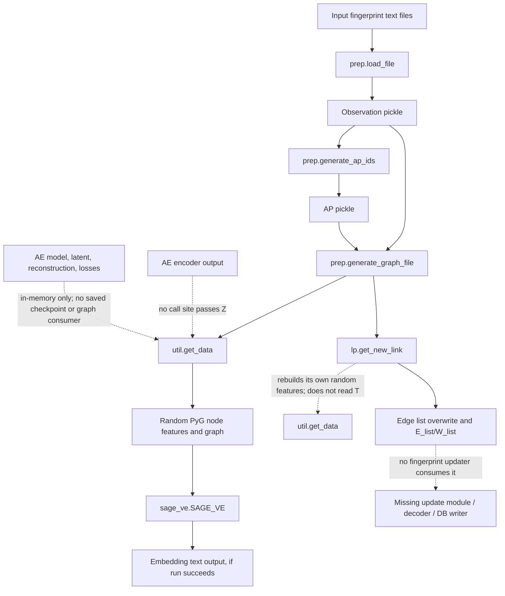
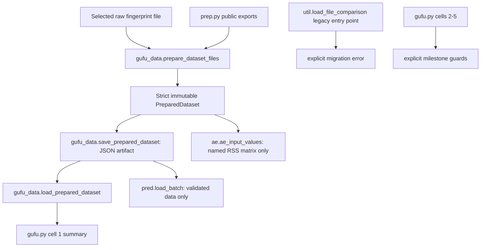
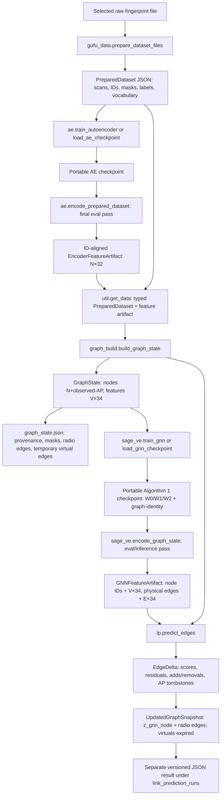
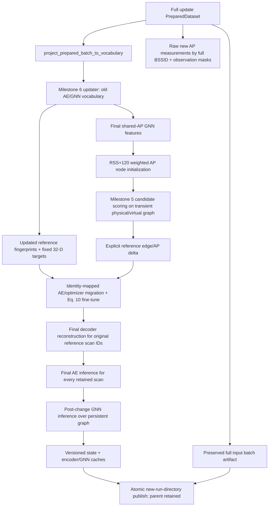
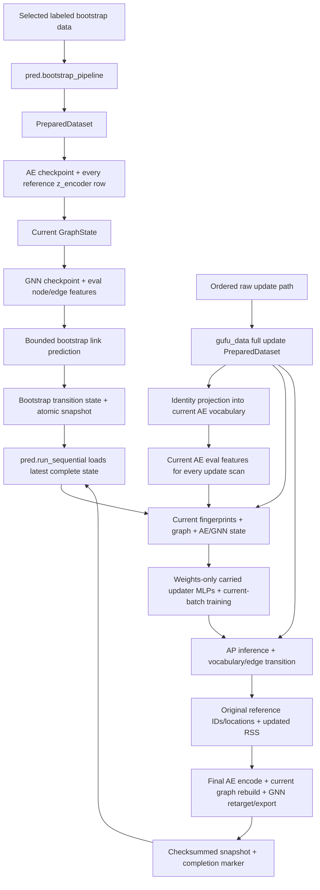

# GUFU repair plan

**Status:** milestones 1–10 are implemented and validated on deterministic small fixtures and a bounded real-data CPU smoke. The test suite and clean-root `gufu.py` script workflow passed. Full real-data execution with the paper-threshold virtual graph, editor-driven interactive cell execution, and held-out localization accuracy remain unverified; see [`gufu_validation.md`](gufu_validation.md).

**Scope guard:** `gufu.py` is the implementation notebook: preserve its `# %%` cells and edit that file as later milestones are implemented. The original preprocessing cell deleted `output/`; milestone 1 replaced that with a unique prepared artifact, and later milestones preserve existing outputs. This document is the standing repair contract for future work.

## Standing instructions

1. Implement one requested milestone at a time. Changes across modules are allowed when required by that milestone's interface.
2. Use real learned state across stages. Do not use random embeddings, silent placeholder outputs, or fallbacks to untrained models in the operational pipeline.
3. Reuse checkpoints and configuration; preserve model, dataset, vocabulary, node, and batch identity. Keep encoder features, graph features, and decoder inputs as separate named feature spaces.
4. Do not expose update or evaluation coordinates to training as labels. Keep bootstrap labels and evaluation-only truth separate.
5. Preserve user data and unrelated edits. Do not recursively delete `output/`, change branches, commit, push, or upgrade environments without approval.
6. Keep model logic in modules; notebook cells call shared APIs. Preserve the existing repaired AE unless evidence warrants a separately documented change.
7. For underspecified mathematics, implement only a defensible, named, tested inference and record it. Never call an inferred variant author-verified. Stop the affected milestone if no consistent implementation can be justified.
8. Each implementation milestone must include tests, necessary notebook edits, and a plan update. Report files changed, commands and results, assumptions, remaining blockers, and exact cells to run. Never report an unexecuted test as passed.

## Inspection record

- Checkout: branch `main`, `HEAD`/`origin/main` at `e1f14c7` (`Move from private account`).
- Initial working tree had modified `ae.py`, `lp.py`, and `prep.py`; untracked `gufu.py`, `gufu.ipynb`, `__pycache__/`, and `output.bkp/`. These are pre-existing user state and must be preserved. `output/` contains tracked artifacts.
- No `AGENTS.md` was present in the checkout or its filesystem ancestors, so no guidance file was changed or created. This plan is the persistent instruction source for this repair.
- The README says to run preprocessing, AE, SAGE-VE, link prediction, then `pred.py`. The current code does not implement a connected version of that sequence.
- No test files or test directories are present in the checkout. `pytest` is installed in the user's `py314` environment, but no tests were run for this inspection-only task.
- Environment metadata was read from `/home/oem/micromamba/envs/py314` (the environment shown in the reported traceback): Python 3.14.6; PyTorch 2.12.0; torch-geometric 2.8.1; torch-sparse 0.6.18+pt212cu130; NumPy 2.5.3; pandas 3.0.3; NetworkX 3.6.1; SciPy 1.18.0; Pydantic 2.13.4; pytest 9.1.1; ipykernel 7.3.0. `notebook`, `jupyterlab`, and `jupytext` are not installed there. The tool's default shell resolves a separate Python 3.9.23 without these project packages; future project commands should explicitly use the `py314` interpreter unless that environment changes.
- Primary paper: [PDF](https://www.cse.ust.hk/faculty/gchan/papers/IMWUT25_GUFU.pdf), [DOI 10.1145/3712277](https://doi.org/10.1145/3712277). Its text, equations, figure captions/labels, and Algorithms 1–2 were accessible. No paper source was unavailable. Relevant figures are summarized below rather than treated as executable specifications.
- Primary repository: [khchiuac/GUFU](https://github.com/khchiuac/GUFU). The local tracked files correspond to the repository baseline plus the working-tree edits recorded above; inspect those edits before each future change.

## Inspected baseline call graph before milestone 1



### Calls, outputs, and missing consumers

| Stage / caller | Actual outputs and shape/format | Current consumer | Missing or incorrect handoff |
|---|---|---|---|
| `gufu.py` cell 1 → `prep.load_file` | Per input folder, reads only `fingerprint0*`; builds Python records `[scan_id, device_id, coordinate, {MAC: RSS}]`. Writes `_observations_<floor>.pkl` and `_observations_prune_<floor>.pkl`. | `generate_ap_ids`, then graph generation. | The cell deletes all of `output/` first. It creates path variables for pruned AP/graph artifacts but never writes them. It only bootstraps from `fingerprint0`, not all batches. `prep.load_file`'s `prune` flag does not prune. |
| `prep.generate_ap_ids` | AP records `[AP_id, MAC, None, [[RSS, x, y], ...]]`, persisted as `_APs_<floor>.pkl`. | `generate_graph_file`. | AP history mixes signal values with coordinates. No explicit ordered vocabulary manifest or stable typed key contract. |
| `prep.generate_graph_file` | Text rows `sample_id AP_id RSS+120` in `<floor>.edgelist`. | `util.get_data`. | It writes only observed AP/sample edges; no learned sample features, AP weighted-average feature table, virtual edges, or feature provenance. |
| `gufu.py` cell 2 / `ae.py` main | `load_file_comparison` returns records and a `mac_all` list. AE trains a fresh model; `z` and reconstruction have shape `[1, 1, 32]` and `[1, 1, num_APs]` per sample in the edited `ae.py`. `outputs`/`losses` remain Python lists in memory. | None in the graph path. | No checkpoint, vocabulary/config metadata, batch embeddings file, or call passing learned `z` to `get_data`. Current AE training script uses `RSS/120` and missing `-1`, contrary to the module comment and paper's `(RSS+120)/120` and missing `0`. |
| `util.get_data(edgelist, Z=zeros(100,100), emb_dim=8)` | Returns `(x_list, PyG Data)`; `Data.x` is `[2, num_nodes, 8]`, two identical copies of freshly sampled random per-node vectors; `edge_index` is `[2,E]`; weights are `[E]`. | `SAGE_VE` and `lp.get_new_link`. | It never consumes AE output unless a caller supplies `Z`; no caller does. `k_virtual` instead receives a fixed zero matrix, uses top `K+1` indices rather than paper's cosine threshold, and treats its row indices as graph node indices despite unrelated node ordering/size. `x_list` comes from a set, so order is not stable. Every call regenerates random features. |
| `sage_ve.SAGE_VE.run` | Intended to write an embedding-like text file, e.g. `output/<floor>/output/cur_out.txt`; no checkpoint is saved. | None. | `run` requires a `model` argument that notebook/pred callers omit. It resets model parameters per run. Its output path does not serialize reusable learned state, and the writer indexes `data.x[i]` as if its first axis were nodes although `data.x` has first dimension 2. More fundamental import, shape, loss, and call-signature defects are listed below. |
| `lp.get_new_link` | Intended return `(E_list, W_list)` and rewrite an edgelist. | Notebook prints results; `pred.py` stores lists in local variables. | Rebuilds `Data` and random `G,F` vectors instead of consuming learned GNN embeddings; does not apply a consistent paper-space threshold; its current writer treats PyG `Data` as a NetworkX graph. No later stage updates fingerprints from predicted links. |
| `pred.py` / `gufu.py` cell 5 | Attempts to train/update, write `cur_out.txt`, train SAGE-VE, and rewrite an edgelist for five files. | None after the script/cell. | Does not implement the paper's two-MLP updater, batch graph lifecycle, decoder call, or fingerprint database write. It creates new AE models per iteration, uses inconsistent graph paths, and does not preserve any stage checkpoint. |
| `graph.py` | A separate NetworkX `Graph` reader/lookup helper. | No direct caller in the notebook pipeline. | Not connected to `util.get_data`/PyG training and does not bridge or validate model outputs. |

## Call graph and outputs after milestone 1 (historical checkpoint)



At the milestone 1 checkpoint, cell 1 selected `input/GF/fingerprint0.txt`, assigned `dataset_id=GF`, `batch_id=fingerprint0`, and the `bootstrap_reference` role, then wrote under a UTC-microsecond run directory in `output/prepared_runs/`. It reloaded the JSON through schema validation and printed counts. At that checkpoint, cell 2-5 were guarded.

`PreparedDataset` contains scan records, source and batch provenance, the ordered BSSID/AP identity mapping, raw dBm and a parallel boolean observation mask, bootstrap label coordinates, evaluation-only coordinate truth, the preprocessing configuration, dropped rows, and parsing counts. `pred.load_batch` only loads a prepared artifact. No graph, GNN, LP, or fingerprint updater consumes it yet. The old `util.load_file_comparison` entry point now raises an explicit migration error rather than parsing an incompatible second representation.

## Call graph and outputs at the milestone 2 checkpoint

```mermaid
flowchart TD
  F[Selected raw fingerprint file] --> P[gufu_data.prepare_dataset_files]
  P --> D[PreparedDataset]
  D --> J[prepared JSON via shared artifact helpers]
  J --> C[gufu.py cell 1 load/inspect]
  C --> T[ae.train_autoencoder: bootstrap rows only]
  T --> K[portable AE checkpoint: E + D + config + data/vocabulary + Adam/RNG/progress]
  K --> L[ae.load_ae_checkpoint: compatibility validation]
  L --> E[ae.encode_prepared_dataset: separate eval/inference pass]
  E --> Z[encoder feature JSON: one z_encoder[32] row per scan ID]
  E --> R[ae.reconstruction_diagnostic: small eval summary]
  Z --> G[gufu.py cell 3 guard at this checkpoint: graph consumer not implemented]
```

Cell 2 uses the exact `PreparedDataset` loaded in cell 1; it does not parse raw files or create a second RSS matrix. The safe notebook default is `AE_ACTION="load"`. Training must be requested explicitly, refuses an existing checkpoint by default, and only accepts a bootstrap-reference dataset. Checkpoints bind dataset/batch identity, exact ordered vocabulary/hash, normalization, architecture, loss/training configuration, progress, optimizer, and relevant CPU/CUDA/shuffle random state. Encoder output is computed only after training from the persisted final weights, in evaluation mode, over all retained scans in prepared scan order. The feature JSON carries those scan IDs and checkpoint/vocabulary/dataset provenance. This paragraph records the state at the end of milestone 2.

## Call graph and outputs after milestone 5 (historical checkpoint)



The operational graph path consumes the saved AE artifact and joins encoder rows by `scan_id`; it does not parse edgelists, infer IDs from sets, or fabricate node features. The obsolete positional `get_data(edgelist, Z=zeros, emb_dim=...)` contract is removed. `sage_ve.py` consumes `GraphState`, saves one explicitly selected independent training run, reloads that checkpoint, and exports features after a separate eval/inference pass. `lp.predict_edges` requires that graph plus an exactly compatible, ID-aligned `GNNFeatureArtifact`. It produces a delta and separate learned-feature graph snapshot; it does not rewrite the input graph file. Cell 4 saves/reloads a timestamped result and displays the proposed changes. Cell 5 was guarded at this checkpoint; milestone 6 replaced it, as recorded later.

## Current call graph and outputs after milestone 6

```mermaid
flowchart TD
  R[Reference PreparedDataset + bootstrap GraphState] --> AE[Selected AE checkpoint and reference encoder rows]
  AE --> GNN[Selected GNN checkpoint and reference GNN node/edge rows]
  GNN --> LP[Optional successful LP snapshot: current edges/features]
  U[Update PreparedDataset + same-vocabulary encoder rows] --> UG[Temporary combined reference/update graph]
  LP --> UG
  GNN --> UG
  UG --> GT[Weights-only GNN update with Eq. 4; final eval output V×34]
  GT --> M1[MLP 1: sample graph features 34 → scaled locations 2]
  M1 --> M2[MLP 2: predicted locations 2 → AE latent features 32]
  M2 --> E59[Section 5.2 losses Eqs. 5–9]
  M2 --> AE10[AE Eq. 10 fine-tuning; E(X), D(E(X)), D(Z_X)]
  E59 --> CK[Compound inference checkpoint: both MLPs + updated GNN + updated AE]
  AE10 --> CK
  CK --> OUT[Versioned dBm artifact: all original reference scan IDs/locations]
  UG -. after all required losses and exports .-> DROP[Retire update scans and virtual edges]
```

`fingerprint_update.prepare_fingerprint_update` validates the prepared/encoder/model/vocabulary identities, optionally consumes the successful milestone 5 snapshot, and constructs the transient graph and cross-virtual adjacency. `train_fingerprint_update` updates a copy of the selected GNN with a fresh optimizer, trains both updater MLPs and fine-tunes a copy of the selected AE. It saves all four network states and optimizer state, then computes final outputs from the reloaded checkpoint. The updated fingerprint artifact has one row for every original reference scan, in original scan order, with original coordinates where available, ordered BSSID metadata, raw measured RSS/masks, inverse-normalized decoder outputs for labeled reference rows, and explicitly retained original values for unlabeled reference rows. New-batch predicted locations are separate outputs; new samples are not appended to the persistent reference table. Temporary samples and virtual edges remain through training/inference and are omitted at the output boundary. Cell 5 calls this module; cell 6 remains guarded for milestones 7–8.

### Confirmed defects in the inspected baseline (historical, before milestone 1)

- The original `gufu.py` had no `if __name__ == "__main__"` guard and its first cell recursively removed `output/`. That implementation was replaced in milestone 1; the notebook was not run.
- The original standalone `prep.py` targeted `output_test` and also recursively removed it. Its preprocessing script has been replaced by public exports of the shared API.
- The original `prep.load_file` stripped the first three characters from each BSSID while `util.load_file_comparison` kept the full MAC. The checked-in input uses bare MACs such as `C8675EBF4217`. Both independent parsers were removed from the operational path. `util.load_file_comparison` now errors with migration guidance; `gufu_data.prepare_dataset_files` is authoritative.
- The editing-time AE correction changes its input contract from the failing 4D reshape to `[batch, 1, AP]`, validates it, and uses one-dimensional integer kernels plus length-preserving padding. This is a local user change and must be preserved unless later evidence and a separate documented decision justify changing it. The training code around it still normalizes incorrectly, initializes `x_all` twice, and records `epochs` instead of the current epoch in each output tuple.
- `sage_ve.py` imports `utils` and `config`, neither of which exists in this checkout. Its class declaration references undefined `sigma`. Further static defects: `run(..., model, ...)` callers omit `model`; `train` calls undefined `simga`; `LossFunc.forward` requires three arguments but callers provide too few; `SAGEConv` is called with `edge_weight` in the positional `size` slot; the constructed input feature count is 16 although `get_data` supplies 8-wide node vectors; `Data.x` is rank 3 though ordinary homogeneous `SAGEConv` expects node-feature matrices; and the current objective/output do not implement the paper's edge-feature aggregation. These are inspection findings, not runtime test results.
- `lp.py`'s local edit accepts `t_threshold`, but its current inner loop obtains node 0's neighbors for every node (`find_indices(..., 0)`). `new_G = G` and `new_F = F` alias the originals, so its convergence comparison is identically zero after assignment. The current nested `torch.abs(torch.add(...), weight)` call passes an unsupported second positional argument to `torch.abs`. It computes all node pairs instead of only valid AP/sample candidates, calls `add_edge` on PyG `Data`, then passes that `Data` to `nx.write_weighted_edgelist`. It normalizes weights to maximum 1 and then tests a score against `>30`, so the condition cannot pass. `lp.py` also imports `graph.*` and `util.*` and relies on incidental star-import names.
- `gufu.py` imports `from lp.py import get_new_link`, which tries to import a `py` submodule from the `lp` module; `lp.py` is not a package. The update cell calls `f.write(outputs)` with a list rather than text, calls `SAGE_VE(get_data(...))[1]` as though the model were subscriptable, refers to paths for per-batch edge lists that preprocessing never creates, and rewrites each current edge list in place.
- `pred.py` duplicates the same training code and defects. It creates a new AE for each update and does not save or load model state. Files named `fingerprint1..4` contain coordinate fields, so their coordinates must remain in an evaluation-only channel if those files serve as update batches.
- Existing `output/` contains only `_observations*`, `_APs*`, and `.edgelist` files in `raw_data/`; no embedding/checkpoint or updater artifacts are present. `output.bkp/` and `__pycache__/` are pre-existing untracked items; leave them untouched.

## Shared data/state contract

Milestones 1–4 implement the prepared-data, AE, graph, and GNN portions below. Decoder/update inputs remain future contracts.

| Entity | Proposed canonical representation | Identity / invariants |
|---|---|---|
| Run manifest | `RunManifest`: schema version; site/floor; bootstrap batch ID; ordered input file list and content hashes; RSS parser/normalizer and thresholds; model configs/seeds; parent artifact IDs; code revision; creation time. | One manifest per reproducible pipeline state. Every artifact names its parent manifest/checkpoint and data revision. |
| Scan | Implemented `PreparedScan(scan_id, dataset_id, batch_id, source, timestamp, rss_dbm, observation_mask, coordinate_role)` plus separate position tables. | ID is SHA-256 over dataset, batch, logical source path, physical one-based row, and source-record hash. It does not depend on coordinates or input-file order. A new batch changes the namespace. Duplicate source paths/rows and scan IDs are rejected. |
| AP | Implemented paired `bssid_vocabulary` and `ap_ids` arrays in `PreparedDataset`. | Full 12-hex MAC, uppercase and separator-free; colon, dash, dotted, and bare forms canonicalize. Prefixes and non-MAC identifiers are rejected. AP ID is `ap:<full canonical BSSID>`. |
| AP vocabulary | Implemented ordered immutable `bssid_vocabulary` and one-to-one `ap_ids`. | Default order is lexicographically sorted full BSSID, independent of input row/file order. Optional `PreprocessingConfig.base_bssid_vocabulary` keeps its order and appends newly observed BSSIDs sorted. Model checkpoint binding remains for a later milestone. |
| RSS spaces | Implemented `rss_dbm [N,A]`, boolean mask `[N,A]`, named AE conversions, and graph-weight conversion. | Missing entries store -120 dBm and `mask=False`; observed -120 dBm remains `mask=True`. `paper_ae` is `(dbm+120)/120` for observed values and 0 for missing. `legacy_raw_div_120` reproduces observed `dbm/120` and missing -1. Graph weight is `dbm+120` for observed readings and `None` for missing. Threshold defaults to none; randomized-MAC pruning defaults off; either is applied once before vocabulary allocation. |
| Labels and masks | Implemented immutable `reference_positions` and `evaluation_positions` tables keyed by scan ID; scan records carry coordinate availability/role. | Bootstrap coordinates are `bootstrap_train`; update coordinates are `evaluation_only`. `training_reference_positions()` returns bootstrap labels only. No update-label training interface exists. Source coordinate units are retained without an inferred transform. |
| Encoder features | Implemented `EncoderFeatureArtifact`: `feature_matrix [N,32]`, generated after training by one loaded final AE and its exact AP vocabulary. | Name and persist separately from graph node/edge features and decoder latents. No regenerated or random substitute. Exact batch and scan order are carried by IDs alongside the matrix. |
| Graph nodes | Implemented `GraphState.node_ids`, `node_id_to_row`, `node_types`, `node_features [V,34]`, sample/AP ID lists, per-node reference/new masks, coordinate-label mask/targets, and provenance. Sample rows follow `[z_encoder (32), location_input (2)]`; AP rows are observed-RSS-weighted means of neighboring sample vectors. | Encoder width is 32; graph width is separately named as 34. Bootstrap labels populate label-available targets; unknown/update coordinates have `None` targets and an explicit label mask. Update samples use a stable hash-seeded pseudo-location input; no evaluation truth enters the feature rows. |
| Graph edges | Implemented separate `radio_edges` and `virtual_edges`. Each edge record carries stable endpoints, an optional scalar weight, and a 34-D endpoint-mean vector feature. | Radio edges join observed sample/AP pairs and use `RSS+120`; virtual edges join distinct sample nodes only. Relations are stored once as undirected pairs; `edge_index_tensor` expands both directions. Virtual edges are temporary through GNN initialization and are marked for removal after aggregation. Their scalar weight is `None` because the paper does not specify one. Predicted AP/sample edges remain a later LP artifact. |
| Graph features / GNN output | Implemented `GNNFeatureArtifact`: `z_gnn_node [V,34]` keyed by node ID, updated physical `z_gnn_physical_edge [E_radio,34]` keyed by edge ID, plus initial virtual edge vectors and provenance. `UpdatedGraphSnapshot` records post-LP `z_gnn_node`, canonical radio pairs, label/role masks, vocabulary, parent graph/GNN checkpoint, and orphan AP tombstones; temporary virtual edges are absent. | Exact graph/node order, topology, dataset/batch, prepared hash, encoder artifact/checkpoint, normalization, and vocabulary are checkpoint-bound. GNN features remain distinct from `z_encoder` and are not passed directly to the RSS decoder; an explicit 32-D decoder-latent adapter/head remains for the updater milestone. |
| Link prediction / updated graph | Implemented `EdgeDelta`: score/threshold units, iteration status/residuals, final goodness/fairness `[V,34]`, candidate score table, explicit added/removed/changed pairs, and AP removals. `UpdatedGraphSnapshot` is the separately versioned complete post-LP state. | Both artifacts bind to exact parent graph and GNN checkpoint identity. Store each undirected radio pair once; directed consumers expand two arcs with one shared scalar weight. Retained links keep their scalar/RSS and GNN physical edge vector. Added links use Eq. (13)'s denormalized shifted-RSS weight and a named GNN endpoint-mean edge-vector initialization. Removed APs remain in ordered vocabulary/AP IDs as tombstones. Virtual edges expire after candidate generation. |
| Decoder input / reconstruction | `z_decoder [N,32]`; `rss_reconstruction [N,A]` in normalized RSS space; transform back to dBm only at output. | Uses the AE decoder and the identical AP-column vocabulary. Decoder input provenance identifies whether it is the trained encoder latent, a named update-MLP estimate, or an explicitly inferred mapping from graph output. |
| Checkpoints | Implemented AE checkpoint contains encoder and decoder state dicts, architecture/config, optimizer, epoch history/progress, seed/config, ordered vocabulary hash, normalization, exact training dataset identity, CPU/CUDA/shuffle RNG, and source checkpoint hash for weights-only/resume. Implemented GNN checkpoint contains all W0/W1/W2 weights, strict model/training config, final epoch/history, graph topology, ordered IDs, vocabulary and upstream AE provenance. | Load validates exact graph, node order, edge topology, dataset/batch, normalization, and vocabulary before inference. AE resume preserves optimizer/progress/RNG; the GNN API makes no resume claim and loaded GNN checkpoints are inference-only. Missing or incompatible state is an error; there is no untrained fallback. |
| Batch transition / provenance | Implemented batch role, dataset/batch IDs, logical source file, physical row, source file/row hashes, preprocessing config, and dropped-row report. | Scan IDs are batch-namespaced. `BatchState`, AP transitions, checkpoint lineage, and updated RSS provenance remain for later milestones. |

## Paper behavior, verified defects, and implementation choices

The paper has a two-stage overview (Fig. 2): bootstrap AE → weighted sample/AP graph plus virtual sample edges → trained GNN; online batch → shared-AP encoder/graph inference → two-MLP update and AE decoder; edge prediction adds missing AP/sample edges and forgetting removes obsolete AP nodes/edges. Figures 3–5 describe the AE and sample virtual-edge thresholding; Fig. 6 depicts AP/sample candidate edge prediction; Fig. 7 illustrates goodness/fairness. These descriptions are taken from the PDF figures/captions and adjacent text, not inferred from the old code.

| Area | Paper-specified behavior | Confirmed checkout defect | Implementation choice / status |
|---|---|---|---|
| RSS input and normalization | `X ∈ R^(N×n_s)`, `Y ∈ R^(N×2)`. Missing APs are `-120 dBm`; normalize each value as `(RSS+120)/120`. Same rule for unlabeled batch `U`. | Baseline used `RSS/120`, filled missing with -1, and had no mask. `prep.py` truncated MACs; loaders differed on threshold/pruning. | Implemented in `gufu_data`: full canonical BSSIDs, raw dBm/mask, paper AE conversion, named legacy conversion, and graph weight conversion. Default threshold is none, pruning off, malformed rows drop with provenance, empty scans kept. Bootstrap and evaluation coordinates are separate. |
| AE (Sec. 4.1, Fig. 3; Eqs. 1–3) | `Z_X=E(X)`, `X_hat=D(Z_X)`, `Z_U=E(U)`, minimize the printed Frobenius objective `L_F=||X-X_hat||_F`. Implementation details specify dropout 0.5 and encoder input width equal to bootstrap MAC count, output width 32. Fig. 3 shows dense 256/32 stages, Conv1D stack and dropout. | Before local repair, input was reshaped `[1,1,1,A]` for `Conv1d`; the working-tree AE repair corrected its shape and uses a 32-wide latent via padding. The standalone training experiment's ReLU decoder could become entirely inactive for its initialized data/model, yielding zero encoder gradients and constant-mean reconstructions. | Trains on all `PreparedDataset` scans and exports ID-aligned final-eval features. Current local AE uses LeakyReLU (`slope=0.1`) at all four activation sites, Kaiming-uniform initialization (`fan_in`, `a=0.1`) for Conv1d/ConvTranspose1d weights, and zero biases for those convolution layers. `AETrainingConfig.loss` selects raw minibatch Frobenius norm or element-mean MSE; the paper prints Frobenius, and MSE is a local alternative, not author-verified. Checkpoints record the objective/history reduction and architecture v2; old ReLU architecture checkpoints are rejected. Symmetric same-length padding and dropout placement/probability remain local inferences, recorded in `AEModelConfig`. |
| Initial graph (Sec. 4.2) | One sample node per scan; AP nodes correspond to observed APs; only observed sample/AP pairs have radio edges, with `w_xm = x_m + c`, `c=120`. A sample graph feature is `[z_encoder(32), location_input(2)]` (34 dims). AP features are radio-weighted means of neighboring sample features. | The former edgelist path discarded learned features. `util.get_data` created fresh random `[N,8]` features, duplicated them on a goodness/fairness axis, and used set-derived node order. | Implemented `build_graph_state(PreparedDataset, EncoderFeatureArtifact)`: joins by scan ID, keeps one `[V,34]` matrix, preserves masks/labels and provenance. Radio scalar weight is `RSS+120`; vector edge feature is endpoint mean. An AP with no observed edges is omitted from nodes but retained in the vocabulary and an explicit omitted-ID list. An observed AP with total edge weight zero errors because its paper weighted mean is undefined. |
| Virtual sample edges (Sec. 4.2; Figs. 4–5) | The paper defines sample node inputs as `[z_encoder, location]` and says cosine is applied between sample node feature vectors; implementation details set `σ=0.95`. | Former `k_virtual` defaulted to a zero matrix `[100,100]`, divided by zero norms, selected top `K+1`, and treated AE row indices as graph node rows. | Current local variant `z_encoder_signal_only_v1` computes cosine on separately preserved `z_encoder` signal rows only (`encoder_feature_dim`, normally 32), because location must not influence signal-neighbor selection. This is a named departure from the paper's literal augmented-vector wording, not an author-verified correction. Coordinates remain in `[z_encoder, location]` node rows, AP weighted means, physical/virtual endpoint-mean edge vectors, GNN aggregation, and updater location losses. Zero-norm signal pairs are omitted. Relations are one canonical undirected pair and can be expanded into both arcs. `top_k_alternative` remains opt-in. Virtual scalar weight is `None`; virtual edge vector is still the mean of the full endpoint graph vectors. Edges remain temporary through GNN/updater consumers. |
| GNN / edge aggregation (Algorithm 1; Eq. 4) | Initialize edge feature `z_uv=(z_u+z_v)/2`; each layer forms `φ(W0·CONCAT(z_uv,z_u))`, aggregates into the receiver node, combines aggregate with its prior feature through `W1`, and L2-normalizes. Update/normalize physical edge vectors with `W2·CONCAT(z_u,z_uv,z_v)`. Eq. 4 sums `-log(φ(z_uᵀz_v))` on original and virtual edges. Implementation details give learning rate .01, dropout .5, 50 epochs, and ReLU. | Original local `sage_ve.py` had missing imports/undefined names, used the PyG `SAGEConv` third positional argument as if it were an edge weight, used 16-D configured inputs against 8-D random rows, passed rank-3 node tensors, and had an unrelated invalid loss. | Implemented direct tensor operations in `sage_ve.py`, with named `mean_edge_neighbor_message_v1`, 34-D dimension-preserving layer widths, dropout after ReLU, endpoint order sample→AP, Adam, and epsilon-clamped ReLU/log as explicit inferences. Scalar `RSS+120` is used in AP initialization upstream; Algorithm 1 messages and Eq. 4 consume 34-D edge vectors and node vectors, not scalar weights. The checkpoint binds its training graph; inference can run on that graph or a graph with the same dataset, AE checkpoint, normalization, vocabulary, and graph-builder config without retraining. |
| Online update (Sec. 5; Eqs. 5–10) | New batches use the same AE and existing AP vocabulary for shared APs. Paper text says new samples start with a random 2-D location value concatenated with `Z_U`; GNN aggregates new plus existing sample nodes. Two MLPs predict new-sample coordinates and updated sample features, with decoder reconstructing updated RSS. Eqs. 5–9 define supervised and virtual-neighbor consistency losses; after a batch, temporary virtual edges/new sample nodes are removed. Eq. 10 retrains AE using reconstruction plus feature/decoder consistency. | No update MLP exists in `gufu.py`, `pred.py`, or modules. Local data files contain coordinates even when treated as later batches. No code writes updated RSS back to existing bootstrap fingerprints. | **Milestone 6 resolution recorded before coding:** fit a GNN-feature→normalized-location MLP on available bootstrap labels; cascade its predicted new locations through a learned location→32-D AE-latent MLP, supervised by current-batch encoder features. Use only cross-batch virtual neighbors to form a row-normalized update→labeled-reference adjacency. This retains the paper's location-conditioned updater and gives a trained, decoder-compatible output space. Update-batch coordinate truth is never read. The equation interpretation and dimensions are recorded below; this is an inferred, tested variant, not author-verified. |
| AP changes / edge prediction (Sec. 6; Eqs. 11–13; Algorithm 2) | Normalize by `w_max`; initialize vector goodness/fairness from extracted node features; iterate Eq. (11)–(12). Predict `w_hat_sv=(w_max/2)(G(s)·F(v)+F(s)·G(v))`. Add a supported missing edge above threshold, remove a below-threshold existing edge, then delete orphan AP nodes. Text gives `δ=120-max|X_ij|`; implementation details separately give `epsilon=0.1` for LP threshold. | Original `lp.py` had node-0 neighbor lookup, aliased buffers, malformed arithmetic, false convergence, all-pairs candidates, impossible `>30` normalized comparison, and invalid PyG/NetworkX calls. Algorithm 2's `v∉N(s)` guard contradicts its later existing-edge removal branch. | Implemented in `lp.py` from compatible learned GNN features. A named inference uses radio `RSS+120` normalized by physical `w_max`, virtual cosine as its LP-only normalized weight, and the implementation-detail `0.1` as a raw shifted-weight threshold; Eq. (13) is denormalized before comparison. Existing edges are independently scored to make Sec. 6.2 forgetting reachable; supported non-edges require AP–sample–virtual-sample evidence. Retained edges keep their weights, so `changed_edges` is explicitly empty under this rule. A pure apply function returns a separate snapshot with orphan AP tombstones and no temporary virtual edges. Not an author-verified exact reproduction. |

### Equation and tensor-dimension issues to resolve before the affected milestone

1. **AE length and output width:** paper states input `X:[N,A]` and output features width 32; a Conv1D interface needs `[N,C,L]`, so the natural wrapper is `[N,1,A]`. The local candidate maps `[N,1,A] → [N,1,32]` and reconstructs `[N,1,A]`. The original unpadded kernel sequence on the 32-wide vector would shrink to width 16. Paper does not state enough padding/channel details to establish the local padding choice as author-verified.
2. **Graph/GNN output width — resolved for milestone 4:** graph node and initial edge inputs are `[V,34]` and `[E,34]`. Algorithm 1 concatenations are `[E_directed,68]` for edge+neighbor, `[V,68]` for self+aggregate, and `[E_radio,102]` for endpoint+prior-edge+endpoint. Output width and layer count are not specified. The implemented dimension-preserving 34-D widths and two-layer default are named implementation inferences. Graph features still include two location channels while the AE decoder expects a 32-D signal latent, so a decoder handoff still needs a separate tested 32-D adapter/head in the updater milestone.
3. **GNN aggregation/loss — resolved for milestone 4:** `AGG` is not concretely selected in Algorithm 1; nearby text gives mean aggregation as a GraphSAGE example. The named `mean_edge_neighbor_message_v1` averages transformed edge+neighbor messages over one incoming arc per neighbor. It does not apply the scalar RSS weight in the message because the algorithm line has no scalar multiplier and virtual scalar weights are unspecified. Eq. 4 uses ReLU then `log`; zero/nonpositive dot products are outside the finite log domain. The implementation retains ReLU and adds only a lower clamp at `1e-12`, sums one term per canonical undirected physical or virtual edge, and errors on edge-empty training graphs. There is no sigmoid, negative sampling, or alternate loss. ReLU/clamp pairs at/below zero have zero gradient; training errors if all model gradients are zero. Since Eq. 4 reads final node embeddings only, a one-layer model's final `W2` edge update has no objective path; earlier-layer `W2` can affect later node layers. These behaviors have focused tests and remain implementation choices where the paper is underspecified.
4. **Updater consistency matrix — resolved for milestone 6 under `row_normalized_cross_virtual_v1`:** the paper prints `Y_X A` and `Z_X A`, while vectors are described as rows. Transpose this as `A_update_ref @ Y_X` and `A_update_ref @ Z_X`, with `A_update_ref:[K,N_X]`. Use only reference rows with available bootstrap labels; `A` marks strict-threshold cross virtual edges, then divides each nonempty update row by its degree. Eq. 7 compares the labeled-neighbor coordinate mean `[K,2]` with trainable `Y_hat_U:[K,2]`. Eq. 8 compares the same adjacency applied to trainable feature-MLP predictions at labeled reference coordinates `[N_X,32]` with fixed new encoder features `Z_U:[K,32]`. Eq. 6 compares feature-MLP output at predicted update locations with the same fixed `Z_U`. Rows without labeled cross-neighbors contribute zero to consistency terms; their scans still contribute Eq. 6. The orientation, normalization, and trainable side are named inferences because the paper leaves them unclear. This is not described as exact reproduction.
5. **Eq. 10 encoder/decoder targets — resolved for milestone 6:** `X:[N_ref,A]` is the paper-normalized reference RSS input; `Z_X:[N_ref,32]` is a detached feature-MLP output at labeled reference positions; `X_hat=D(E(X)):[N_ref,A]`. Optimize the printed Frobenius objective `||X-X_hat||_F + 1/2(||E(X)-Z_X||_F + ||D(Z_X)-X_hat||_F)`. Both E and D receive gradients, and stopping gradients through `Z_X` prevents a circular target. Final updated RSS is `D(Z_X)` from the final updated decoder, inverse-normalized with the same recorded preprocessing mode. `Z_X` is produced by the trained location-to-feature MLP, never cropped from the 34-D GNN output. The paper does not say whether `X_hat` is a fixed baseline reconstruction or a live reconstruction; use live `D(E(X))` in the consistency term and record this choice.
6. **Link threshold and iteration — resolved for milestone 5 under a named inference:** Eq. 11/12 use normalized `w_uv`; Eq. 13's `w_hat` multiplies by `w_max`; text threshold is `δ=120-max|X_ij|`, while implementation details call `epsilon=0.1` the link-prediction threshold and Algorithm 2 also uses epsilon for convergence. Missing RSS is `-120 dBm`, so a dense `X` containing any missing value produces printed `δ=0`; implementation details still provide `0.1` without units. Milestone 5 keeps convergence epsilon and link threshold separate, interprets `0.1` in raw `RSS+120` scalar-weight units after Eq. 13 denormalization, records this as inference, and never compares normalized `[0,1]` scores against a raw threshold.
7. **Virtual edge scalar weight:** the paper sets membership by cosine threshold and initializes the edge vector feature as the endpoint mean, but does not specify a scalar virtual-edge weight. Milestone 3 stores the scalar as `None` and the 34-D vector separately; no scalar value such as `0.5` is inferred. Milestone 4 uses the specified vector message path and does not need to invent this scalar.

### Milestone 6 source-to-code plan (recorded before implementation)

Section 5.2 and Eqs. (5)–(10) were read in the primary [paper PDF](https://www.cse.ust.hk/faculty/gchan/papers/IMWUT25_GUFU.pdf), including the surrounding prose on pages 3:10–3:11. The section says MLP 1 maps signal features to sample locations and is supervised on labeled existing samples; MLP 2 maps existing location labels to updated features. It then gives Eq. (6) on new-batch features and Eqs. (7)–(8) on old/new virtual neighborhoods. The text does not resolve the subscript/orientation conflicts, A normalization, or how 34-D graph output becomes the AE's 32-D decoder input. Those points are handled as named implementation inferences below.

| Tensor / operation | Contract before implementation | Named choice and reason |
|---|---|---|
| `X_ref`, `X_update` | `[N_ref,A]`, `[K,A]`; paper AE-normalized RSS (`paper_ae`: observed `(dBm+120)/120`, missing `0`; compatibility mode remains explicit). | Consume prepared matrices and masks. The update path validates exact ordered AP vocabulary and normalization against the original reference and AE checkpoint. |
| `Z_encoder_ref`, `Z_encoder_update` | `[N_ref,32]`, `[K,32]` from one persisted AE checkpoint, joined by stable scan ID. | The update targets are detached/fixed encoder outputs. Hidden update coordinates are not inputs to any loss, scaling statistic, seed, or graph feature. |
| Online GNN graph and `Z_gnn` | Existing samples/APs plus temporary new samples; node/edge inputs and final GNN nodes `[V,34]`, physical edge vectors `[E_radio,34]`. | Construct one combined graph from the current reference snapshot and update graph. Train a fresh-optimizer, weights-only continuation initialized from the selected GNN checkpoint with Eq. (4), then recompute outputs in eval mode from that final model. This is a batch update, not optimizer resume; temporary nodes/virtual edges live through this step and updater fitting. |
| Location map and `Y_hat_update` | `Y_ref:[N_labeled,2]`, `Y_hat_update:[K,2]`; paper leaves coordinate scale open. | Min-max scale each axis using only available bootstrap labels; a constant axis maps to zero. MLP 1 maps final GNN sample output `[N,34] → [N,2]`; Eq. (5) uses labeled bootstrap rows only. Inverse-scale predictions only for reporting. No label is generated from update metadata. |
| Feature update map and decoder input | MLP 2 consumes location vectors and returns `[N,32]`; AE decoder expects `[N,1,32]` (or equivalent flattened `[N,32]` adapter call). | MLP 2 is a trained map `[2] → hidden → [32]`, matching the paper's location-conditioned second MLP. Its Eq. (6) target is detached `Z_encoder_update`. This is the explicit learned alignment from locations to AE latent space; it is trained by update features and Eq. (8), not a crop, pad, or coordinate-slice assumption. `Z_hat_ref=MLP2(Y_ref)` supplies Eq. (10) targets and decoder inputs. |
| Virtual-neighbor adjacency | Section 5.1 constructs virtual relations over existing and new samples; Eqs. (7)–(8) do not state dimensions or normalization. | Build strict cosine-threshold sample relations from preserved encoder-only `z_encoder` rows and select only cross edges from each new sample to labeled reference samples. Store binary `A:[K,N_labeled]`, divide each nonempty row by its degree. This named signal-only variant excludes locations from neighbor selection; the full graph vector remains available to other consumers. No self-pairs or within-batch/reference-only edges enter these two consistency losses. |
| `L_P`, `L_U`, `L_CP`, `L_CU`, Eq. (9) | Printed as Frobenius norms; Eq. (9) uses `alpha`. | `L_P=||Y_ref_scaled - MLP1(Z_gnn_ref)||_F`; `L_U=||Z_encoder_update - MLP2(Y_hat_update)||_F`; `L_CP=||A Y_ref_scaled - Y_hat_update||_F` over nonempty A rows; `L_CU=||A MLP2(Y_ref_scaled) - Z_encoder_update||_F` over the same rows. `L=alpha(L_P+L_U)+(1-alpha)(L_CP+L_CU)`. `L_U` backpropagates through both MLPs; `L_CP` reaches MLP 1; `L_CU` reaches MLP 2; feature targets and adjacency are fixed. Empty consistency row sets contribute a differentiable zero, while `L_U` remains active. Raw Frobenius norms and row-normalized adjacency are preserved/tested. |
| AE Eq. (10) and RSS export | `E(X_ref):[N_labeled,1,32]`, `D(E(X_ref)):[N_labeled,1,A]`, fixed `Z_hat_ref:[N_labeled,32]`. | Fine-tune a copy of the loaded AE with live `X_hat=D(E(X))`, detached `Z_hat_ref`, and the printed Eq. (10) norms. Save the changed E and D with all other model states. Decode `Z_hat_ref` using the final D, inverse-normalize, and emit values indexed by exactly the original reference IDs/coordinates. Preserve source RSS/mask alongside per-cell decoder-prediction provenance; no new scan is appended. Temporary update IDs and virtual edges are retired only after all losses, final GNN inference, AE fitting and decoder outputs have been computed. |

Implementation inputs are the validated reference `PreparedDataset`, its `GraphState` and `GNNFeatureArtifact`, the optional current LP `UpdatedGraphSnapshot`, the new update `PreparedDataset` and encoder artifact, plus compatible persisted AE/GNN checkpoints. The no-vocabulary-change precondition is exact equality of ordered canonical BSSID tuples, normalization, dataset ID, encoder checkpoint, graph builder config and model identity. Outputs are a separate immutable RSS update artifact and one compound model checkpoint that stores both MLPs, the changed AE and GNN weights, optimizer states, scalar loss histories, seeds/configuration and all upstream IDs/hashes. It is marked weights-only/non-resumable unless a later API adds and tests full continuation state.

### Milestone 5 source-to-code design (recorded before implementation)

The primary source was reread at Section 6.1–6.2, Eqs. (11)–(13), Algorithm 2, Fig. 6 and its caption, and the implementation-details paragraph. The paper text says Fig. 6 candidates are missing AP/sample pairs that meet through a shared sample-neighbor/virtual-neighbor relation. Algorithm 2 spells this as a radio edge from an AP to sample `u`, then a virtual edge from `u` to sample `v`. Its Eq. (11) and Eq. (12) vector updates, and the resulting implementation policy, are recorded here before coding:

| Operation | Source operation | Milestone 5 concrete operation / named inference |
|---|---|---|
| Inputs and vector dimensions | Algorithm 2 takes graph `G(V, E ∪ Evirtual, W)` and extracted node vectors `z_v`. | Require `GNNFeatureArtifact.feature_space=z_gnn_node`, exact matching `graph_id`, node IDs/types/order, vocabulary, dataset/batch, normalization, and edge IDs. Join every 34-D row by its stable node ID; do not read bootstrap/update coordinates. Create independent goodness and fairness buffers `G⁽⁰⁾ = clone(Z)` and `F⁽⁰⁾ = clone(Z)`, both `[num_nodes, 34]`. |
| Radio and virtual scalar weights | Algorithm 2 normalizes `w_uv` by `w_max`; Eqs. (11)–(12) use each neighborhood edge weight. The graph schema stores physical `RSS+120` scalar weights, but virtual-edge scalar weight is unspecified in Sec. 4.2/Algorithm 1. | Named inference `radio_normalized_plus_virtual_cosine_v1`: physical radio edges use `w_uv = scalar_weight / max_radio_weight`; virtual edges use their stored cosine similarity directly as their normalized neighborhood weight. The virtual cosine is not written back as a graph scalar. If `max_radio_weight=0`, radio normalized weights are 0 and virtual weights remain their cosine; prediction scale is 0. Virtual edges contribute to Eq. (11)–(12) neighborhoods and separately establish candidate evidence. |
| Goodness update (Eq. 11) | `g_i^(t+1)(v) = 1/|N(v)| Σ_(u∈N(v)) f_i^t(u) w_uv`. | Synchronous vector operation `G_next[v] = sum_u(F_old[u] * normalized_weight(u,v)) / degree(v)`, broadcasting each scalar over 34 dimensions. Degree is the count of distinct adjacent graph nodes across radio and virtual edges, not a sum of weights. |
| Fairness update (Eq. 12) | `f_i^(t+1)(v) = 1 - 1/(2|N(v)|) Σ_(u∈N(v)) |w_uv - g_i^(t+1)(u)|`. | After the full `G_next` buffer exists, calculate `F_next[v] = 1 - sum_u(abs(normalized_weight(u,v) - G_next[u])) / (2*degree(v))`, broadcasting the edge scalar over the vector. This uses newly updated neighboring goodness, as printed. Buffers are never aliased or updated in place. |
| Isolates and zero weights | Eqs. (11)–(12) divide by degree; normalization divides by `w_max`. Neither zero cases is defined. | Named inference `keep_initial_g_f_for_isolates`: an isolated node keeps its independent previous G/F rows and contributes zero residual. If all radio weights are zero, normalized radio weights and the physical prediction scale are zero; no divide by zero occurs. |
| Iteration order/stopping | Algorithm 2 performs one whole-node update per iteration and loops while both summed vector residuals exceed `epsilon`; the repository version has a 2000-iteration bound and `1e-3` convergence check. | Whole-graph synchronous updates. Residuals are `Σ_v ||G_next[v]-G_old[v]||₂` and the equivalent F sum. Stop when either residual is `<= convergence_epsilon` (the negation of the printed `while residual_G > ε AND residual_F > ε`); otherwise stop at `max_iterations` and return `failed`, with no applicable delta. Default cap 2000, epsilon `1e-3`. |
| Prediction score and units (Eq. 13) | `w_hat_sv = (w_max/2)(G(s)·F(v) + F(s)·G(v))`; Eq. (13) restores the original maximum-weight scale after iteration used normalized values. | Dot the two 34-D vectors in each order, average, then multiply by `max_radio_weight`. Scores and thresholds are in the graph's scalar `RSS+120` shifted-RSS weight units, not normalized `[0,1]` units and not dBm. Added edge RSS is `w_hat-120 dBm`; scalar weight is `w_hat`. |
| Candidate and removal rules | Algorithm 2 requires a radio AP/sample neighbor plus a virtual sample/sample relation, then checks `v ∉ N(s)`. Its later `e_sv ∈ E` removal branch is unreachable under this filter because the candidate is explicitly a non-edge. Section 6.2 nevertheless says existing edges below the threshold are removed. | Candidate universe is the union of (a) all existing physical AP/sample edges, scored independently so forgetting is reachable, and (b) missing AP/sample edges supported by a length-two physical/virtual relation. For each existing edge, remove only when score `< threshold`; otherwise preserve its existing weight (Algorithm 2 does not update weights of retained edges). For each missing supported edge, add when score `>= threshold`. The three result lists are a delta, not the paper's ambiguous `E_n` as a complete edge set. `changed_edges` is explicit and empty under this retained-weight policy. |
| Threshold conflict | Sec. 6 gives `δ = 120 - max |X_ij|`, and explains the shifted-RSS cutoff as nonnegative with missing RSS `-120 dBm`; implementation details separately say `ε=0.1` is the link-prediction threshold, while Algorithm 2 also uses epsilon for convergence. | Keep these as separate parameters. Default to the implementation-details value `link_threshold=0.1`, interpreted in raw `RSS+120` scalar-weight units because Eq. (13) denormalizes its score. This is a named inference, not an author-verified reconciliation. The printed formula yields `δ=0` when the matrix contains the documented `-120 dBm` missing sentinel; it does not establish that the `0.1` value is normalized. The API permits an explicit nonnegative threshold override and records its value/units. |
| Returned graph and AP forgetting | Algorithm 2 returns `E_n,W_n`; prose says added edges and removed edges update the graph, and isolated AP nodes are deleted. It does not define reverse-edge serialization. | Return one canonical undirected physical edge per pair; consumers expand both directed arcs with the same scalar weight. `EdgeDelta` records added/removed/changed edges and orphan AP removals. A pure tested apply-delta API builds a separate, versioned learned-feature graph snapshot, removes temporary virtual relations from that snapshot, preserves every unaffected edge/node, and retains the full vocabulary plus AP tombstones. Input `GraphState` and GNN artifacts remain immutable. New vector edge feature initialization is the documented Algorithm 1 endpoint mean, applied to the supplied GNN node vectors; retained edges keep their learned GNN edge vectors. |

The paper source does not specify a scalar value for virtual edges used by Algorithm 2's weighted neighborhood equations. The cosine-weighted virtual update above is an explicit, tested inference so the API remains mathematically defined; it must not be described as exact author reproduction. If these declared policies fail the hand-computed tests or produce inconsistent units, stop milestone 5 rather than silently changing the equations.

## Notebook-cell replacement checklist

Keep `gufu.py` cells thin and place implementations in modules. Cell 1 now uses the milestone 1 API. No cell was run during milestone 1.

### `gufu.py` implementation notebook (6 current cells)

| Cell | Current role | Planned replacement API / disposition | Status |
|---|---|---|---|
| 1 | Original cell duplicated loaders, looped all folders, and recursively deleted `output/`. | `gufu_data.prepare_dataset_files` → `save_prepared_dataset` → `load_prepared_dataset`; one selected GF/fingerprint0 config, timestamped new run directory, summary inspection. | ☑ Implemented; not executed. |
| 2 | Original code trained AE in memory and recreated normalization/model state. | `ae.train_autoencoder` / `ae.load_ae_checkpoint` → `ae.encode_prepared_dataset`; consumes the loaded prepared artifact and writes a portable AE checkpoint plus ID-aligned final-eval `z_encoder`. | ☑ Implemented; notebook defaults to load; not executed. |
| 3 | Original code called random-feature `get_data` and SAGE-VE. | `load_encoder_features` + `util.get_data(prepared_dataset, encoder_feature_artifact, config)` → saved/reloaded `GraphState` → `sage_ve.train_gnn` or `load_gnn_checkpoint` + `encode_graph_state` → `GNNFeatureArtifact`. | ☑ Graph and GNN paths implemented; cell not executed. |
| 4 | Original code imported LP through invalid `from lp.py ...` path and rewrote edges in place. | `from lp import predict_edges`; use `GraphState` + saved `GNNFeatureArtifact`, persist `EdgeDelta` with its separate `UpdatedGraphSnapshot`. | ☑ Implemented; not executed. |
| 5 | Previously duplicated M6 training/update cell. | Select `UPDATE_INPUT_DIRECTORY`/pattern and build `OrchestrationConfig`; do not parse or train in the cell. | ☑ Updated for milestone 8; not executed. |
| 6 | Previously a one-batch AP transition demonstration. | `pred.run_sequential` bootstraps once, resumes from the latest complete snapshot, runs ordered batches, and prints state/metrics. | ☑ Calls the same implementation as the CLI; not executed. |

### Separate untracked `gufu.ipynb` reference notebook (23 current cells)

This is a duplicate exploratory notebook in the working tree, not the requested implementation target. It was inspected read-only and is not modified by this plan. The table gives each cell a future disposition so it cannot become a second, divergent pipeline.

| Cell | Current source | Planned API/disposition |
|---:|---|---|
| 1 | Hard-coded glob of `output/GF/raw_data/*` | Replace with `state.artifacts` / `gufu.inspect.list_artifacts(state)`; no hard-coded absolute path. |
| 2 | Displays `raw_data_files` | Replace with `state.summary()` or remove as incidental inspection. |
| 3 | Directly unpickles APs/observations/pruned observations by list index | Replace with `gufu.data.load_state(...)` and schema validation; never rely on sorted filenames by numeric index. |
| 4 | Displays `aps` | Replace with safe AP summary keyed by stable AP ID, or remove. |
| 5 | Displays `obs` | Replace with safe sample summary keyed by stable scan ID, or remove. |
| 6 | `from prep import *` | Replace with explicit shared pipeline API imports. |
| 7 | Preprocesses under `output_test` and recursively deletes it | Replace with `prepare_bootstrap(config)`; no deletion. |
| 8 | Empty | Remove. |
| 9 | Empty | Remove. |
| 10 | Duplicate `from prep import *` | Remove; retain one explicit API import/config cell. |
| 11 | Second destructive preprocessing implementation with debug output | Fold diagnostic summary into cell 7's API; remove duplicate preprocessing. |
| 12 | Displays `filename` | Replace with current manifest's input-file/source-row summary, or remove. |
| 13 | Displays observation count | Replace with `state.summary().bootstrap_sample_count`. |
| 14 | Empty | Remove. |
| 15 | Reassigns loader arguments interactively | Remove; configuration must be explicit and immutable for a run. |
| 16 | Redefines `load_file` inside notebook | Remove; shared parser belongs in `gufu.data`/prep API and is unit-tested there. |
| 17 | Displays `observation_ids` | Replace with compact state summary; never dump full sensitive/large record sets by default. |
| 18 | Displays `target_dir` | Replace with `state.paths.raw_data` summary, or remove. |
| 19 | Displays `ap_ids` | Replace with AP vocabulary summary/hash and counts. |
| 20 | Displays `observation_file` | Replace with manifest artifact path/hash listing. |
| 21 | Displays `observation_ids` again | Remove duplicate or replace with a separately named train/eval/mask count. |
| 22 | Displays `filename` again | Remove duplicate or show current batch ID/source file via state. |
| 23 | Empty | Remove. |

## Numbered repair roadmap

Implement only the next requested milestone at a time. Each completed milestone updates this plan, adds/updates tests, edits only the necessary `gufu.py` cells, and reports its changed files and exact cells to run.

1. **Shared preprocessing — complete.** Added `gufu_data.py` with strict immutable Pydantic models, one DB/JSONL parser, deterministic scan/AP identity, explicit filtering and malformed/empty policy, raw/AE/graph conversions, separated bootstrap/evaluation positions, safe JSON artifacts, and a trusted-local legacy adapter. Routed prep/AE/pred/notebook access through it. Cell 1 writes to a new timestamped run directory; no deletion. Added focused tests.
2. **AE persistence — complete.** Preserved the existing repaired AE. `train_autoencoder`, `load_ae_checkpoint`, `encode_prepared_dataset`, and `reconstruction_diagnostic` train from `PreparedDataset`, persist complete encoder/decoder/config/optimizer/RNG/progress state, and export ID-aligned 32-D features after training in a separate eval/inference pass. Cell 2 defaults to load. Focused 673-AP tests cover batch size one, finite backward/update, order/provenance, reload, mismatch rejection, and exact epoch-boundary resume. No full dataset training was performed.
3. **Graph construction — complete.** `graph_build.py` builds stable typed sample/AP nodes from the prepared dataset and ID-aligned AE artifact; it records [V,encoder_dim+2] node features, label/new/reference masks, RSS+120 radio weights, endpoint-mean vector edge features, strict signal-only cosine virtual edges under `z_encoder_signal_only_v1`, stable mappings, and parent provenance. Virtual scalar weight is `None` and temporary lifetime is explicit. Unlabeled coordinate input uses a named SHA-256 seeded pseudo-uniform policy inside configured bounds; bootstrap bounds derive only from reference labels, while update batches require trusted configured bounds. Update truth targets are always absent. Cell 3 loads the AE feature artifact and saves/reloads this state. Added focused tests for AP means, ID joins, duplicates, zero/duplicate vectors, top-K alternative, isolated nodes, shape and serialization. No full graph or notebook run was performed.
4. **GNN training/export — complete.** Implement Algorithm 1's edge-vector messages, node updates, physical-edge updates, Eq. 4, checkpoint load, and final eval feature export. Record AGG, log-domain, width/layer, dropout placement, and optimizer inferences and test the tensor mapping. Cell 3 consumes `GraphState` and exposes GNN checkpoint/features. Cross-batch continuation is deliberately not claimed in this milestone.
5. **Link prediction — complete.** Added strict `predict_edges(GraphState, GNNFeatureArtifact, LinkPredictionConfig)`, exact graph/checkpoint/vocabulary/node/edge compatibility checks, Eq. (11)–(13) iteration and score operations under the named policies below, bounded convergence, explicit `EdgeDelta`, pure `apply_edge_delta`, and a versioned `UpdatedGraphSnapshot`. Cell 4 loads actual learned graph state and saves a separate result. Eight focused synthetic tests cover the selected equations, candidate and forgetting cases, units, masks/identity, limits, immutability, and serialization.
6. **Fingerprint updater — complete for unchanged AP vocabulary.** `fingerprint_update.py` constructs a transient joined graph, applies a weights-only GNN update, trains the two Section 5.2 MLPs and Eq. (10) AE update, and exports inverse-normalized RSS rows keyed to original reference IDs. The named adjacency/target/alignment choices and dimensions are recorded below; no-vocabulary-change is enforced. Cell 5 calls the API and writes separate timestamped artifacts. Synthetic tests include loss references, gradient reachability, hidden-coordinate invariance, changed update signals, identity/reload, and reference ID/location retention. No full data training was performed.
7. **AP/batch transitions — complete.** `batch_transition.py` projects the full incoming dataset into the old AE vocabulary for shared-AP inference, scores new AP edges, applies identity-based vocabulary/graph/RSS/mask migration, archives tombstoned AE slices, restores returning APs, re-fine-tunes the migrated AE, and re-exports final encoder/GNN caches after graph changes. It publishes a new immutable snapshot transactionally. Milestone 8 now drives this API across successive batches.
8. **Orchestration — complete.** `pred.py` exposes `bootstrap_pipeline`, `update_one_batch`, and `run_sequential`; the CLI and notebook use the same functions. It validates exact prepared/model/vocabulary/graph lineage, carries the latest fingerprints and AE/GNN state forward, initializes later updater MLPs from the previous completed updater checkpoint, continues after an edge no-change result, and publishes content-verified atomic snapshots with completion markers. Tests cover multi-batch handoff, AP expansion, no-change followed by later work, interrupted-save recovery, checkpoint/config incompatibility, natural ordering, duplicate avoidance, and resumed-versus-uninterrupted CPU execution.
9. **Notebook integration — implemented.** Preserve `gufu.py` as the Python-file notebook with nine `# %%` cells. Cell 1 selects real-data or CPU-smoke configuration and stepwise or full mode. Cells 2–6 inspect each shared API artifact; full mode defers model work to cell 8. Cell 7 sends one explicit incoming batch through `pred.run_sequential` in an isolated demonstration root; cell 8 resumes/runs the same API used by the CLI; cell 9 optionally evaluates held-out update coordinates after fitting. Both top-to-bottom modes passed a bounded real-file CPU smoke. Keep the separate exploratory `gufu.ipynb` unchanged. Map/report exact cells.
10. **End-to-end verification.** Run isolated tests and a complete pipeline against a copied/temporary dataset output root, preserving tracked `output/`, `output.bkp/`, and input data. Verify artifact lineage, stable node/vocabulary mapping, model checkpoint reuse, eval-only coordinate separation, graph transitions, and finite metrics. Only then report exact `gufu.py` cells safe to run.

## Milestone 1 implementation record

### Files changed for milestone 1

- `gufu_data.py`: strict Pydantic data/config/provenance models; DB and JSONL raw parsing; deterministic IDs and vocabulary; thresholds, randomized-BSSID pruning, duplicate, malformed, and empty-scan policies; explicit RSS conversions; JSON save/load; trusted-local legacy pickle adapter.
- `prep.py`: now exports the shared prepared-data APIs without a second raw parser or destructive standalone script.
- `util.py`: the former duplicate `load_file_comparison` parser now raises a migration error directing callers to `gufu_data`.
- `ae.py`: retains the repaired AE class unchanged; removes its private raw-file training loop and exposes `ae_input_values(PreparedDataset)` using the named normalization API.
- `pred.py`: removes duplicate raw parsing/training and exposes only validated prepared-batch loading; standalone updater entry point reports that later work is not implemented.
- `gufu.py`: preserves five `# %%` cells; cell 1 prepares, saves, reloads, and inspects one selected dataset in a new timestamped directory. Cells 2–5 are explicitly guarded pending their milestones. No recursive deletion remains.
- `tests/test_gufu_data.py`: 18 focused tests.
- `docs/gufu_repair_plan.md`: current contract/call graph, implementation status, roadmap and milestone report.

### Implemented choices and assumptions

- The source row is the one-based physical line. Scan IDs hash `(dataset_id, batch_id, logical source file, source row, row content hash)`. Coordinate equality never merges scans; a different batch cannot reuse an ID.
- Full standard 48-bit MACs are accepted and canonicalized from bare, colon, dash, or Cisco dotted forms. Other identifiers and shortened prefixes are rejected. AP IDs are `ap:<full canonical MAC>`. Default vocabulary order is lexical; `base_vocabulary` preserves old order and appends new observed BSSIDs in lexical order.
- Threshold comparison keeps RSS readings `>= threshold`. Randomized-address pruning uses the IEEE locally administered bit (`first_octet & 0x02`) and is off by default; pruning runs before threshold counting. This is an explicit code/config choice; it is not presented as paper-specified pruning.
- Malformed rows default to drop with source row/hash/reason recorded; callers may select error. Empty scans default to keep, including rows emptied by threshold/pruning; callers may select drop. Duplicate canonical readings default to strongest RSSI; `last` and `error` are named alternatives. Filtering occurs before vocabulary construction and is applied once.
- Raw missing columns use `-120 dBm` plus `mask=False`; an observed `-120 dBm` is distinct (`mask=True`). `paper_ae` is the paper's `(rssi+120)/120` with missing 0; `legacy_raw_div_120` keeps the old observed `rssi/120`, missing -1 behavior. Graph conversion is `rssi+120` for observed readings and no edge weight (`None`) when unobserved.
- `PreparedScan` subclasses the available `data.base.models.base.TimestampedData`, keeping future scan/pose pairing possible. Float timestamps are seconds and convert to integer milliseconds; integer timestamps are already milliseconds. DB source files contain no timestamp, so none is invented. `PreparedDataset` and position tables are frozen strict Pydantic models; there is no `allow_arbitrary_types=True`.
- Legacy pickle loading requires explicit `trusted_local=True`, a source-row crosswalk, full canonical BSSIDs, and exact AP/observation vocabulary agreement. The checked-in historical pickle format lacks source-row metadata and uses truncated BSSIDs, so those artifacts are refused with instructions to regenerate from raw input.
- Notebook output goes beneath a new UTC-microsecond directory in `output/prepared_runs/`; save refuses an existing artifact unless `overwrite=True`. Existing `output/`, `output.bkp/`, and input files were not modified.

### Verification results

- `/home/oem/micromamba/envs/py314/bin/python -m pytest -q -p no:cacheprovider tests` with `PYTHONDONTWRITEBYTECODE=1`: **18 passed**.
- `python -m py_compile gufu_data.py prep.py util.py ae.py pred.py gufu.py` in `py314`: completed successfully.
- `git diff --check`: passed.
- Read-only in-memory parse of `input/GF/fingerprint0.txt`: 392 scans, 673 APs, 392 bootstrap positions, 0 dropped rows. No prepared artifact was written by this smoke parse.
- `gufu.py` was not executed. No actual notebook cell was executed.

### Remaining blockers and exact cells

- No model checkpoint, graph, GNN, link prediction, fingerprint update, AP transition, or orchestration stage consumes the new artifact yet. `gufu.py` cells 2–5 are guarded pending milestones 2–8.
- The old output pickles cannot be safely recovered from their truncated BSSIDs and absent source-row crosswalk; regenerate these from original text inputs if legacy migration is needed.
- **Cell to run for milestone 1:** run only `gufu.py` cell 1 from the repository root. It writes a new JSON artifact under `output/prepared_runs/GF/fingerprint0/<UTC-run-id>/prepared.json`, then reloads and prints its summary. Cells 2–5 are not runnable yet. The cell was deliberately not executed during this work.

## Milestone 1 execution checklist (historical)

- [x] Read applicable AGENTS guidance (none exists for this checkout/ancestor chain).
- [x] Preserve pre-existing `ae.py`, `lp.py`, `prep.py`, `gufu.py`, `gufu.ipynb`, `output.bkp/`, `__pycache__/`, `output/`, and input state while making milestone 1 changes.
- [x] Preserve the repaired AE architecture and keep subsequent stages guarded.
- [x] Add and run the focused milestone 1 test suite; report only executed checks as passed.
- [x] Update this plan with implementation state, assumptions, test results, blockers, and exact cell instructions.

## Milestone 2 implementation record

### Files changed for milestone 2

- `ae.py`: retained the repaired AE layer sequence and `(latent, reconstruction)` return order; added strict model/training/checkpoint/feature contracts, prepared-data-only training, explicit `fresh` / `weights_only` / `resume` modes, portable checkpoint loading, final-weight whole-dataset encoding, and an eval-only reconstruction diagnostic.
- `gufu_artifacts.py`: shared atomic JSON/torch serialization, safe `weights_only=True` checkpoint loading, and canonical SHA-256 helpers. Prepared-data JSON save/load now uses these helpers too.
- `gufu_data.py`: replaced its private prepared-JSON write implementation with shared serialization without changing the schema/API.
- `gufu.py`: replaced only cell 2. It defaults to loading `output/checkpoints/<dataset>/<batch>/ae.pt`, offers explicit training configuration, saves features beneath that cell 1 run directory, asserts count/IDs/shape/vocabulary/checkpoint provenance, and prints a small reconstruction diagnostic. Cells 3–5 remain guarded.
- `tests/test_ae.py`: added 8 focused cases (including three batch-size variants); uses only tiny synthetic 673-AP fixtures.
- `docs/gufu_repair_plan.md`: updated call graph, cell/API mapping, assumptions, verification, and milestone state.

### Implemented behavior and recorded choices

- Training consumes only `PreparedDataset` and requires `batch_role="bootstrap_reference"`. RSS normalization comes from the prepared config; its explicit observation mask is used by the named conversion. Update-batch/evaluation coordinates are not used or accepted for AE fitting.
- The repaired architecture remains unchanged. The checkpoint records `input_dim=A`, dense width 256, latent width 32, one channel, encoder kernels `(3,3,3,11)` with padding `(1,1,1,5)`, decoder kernels `(11,3,3,3)` with padding `(5,1,1,1)`, dropout `0.5`, and the current local dropout placement. Shapes are `[B,1,A] → [B,1,32] → [B,1,A]`, with the model returning `(latent, reconstruction)`. Same-length padding and dropout placement are implementation inferences, not author-verified decisions.
- `AETrainingConfig` records epochs, batch size, Adam learning rate/betas/epsilon/weight decay/AMSGrad, seed, shuffle, dtype, optimizer, and the selected `mean_squared_error` loss. Each minibatch uses `torch.nn.functional.mse_loss(..., reduction="mean")`; epoch history is an element-weighted mean over all processed batch residual entries, stored as detached Python floats. The paper's Frobenius objective remains documented as the source specification; MSE is a local user-selected optimization objective. Checkpoints identify the LeakyReLU/Kaiming architecture v2 and loss definition. The trainer must include every retained scan; its previous diagnostic `torch.arange(1)` order override was removed and the recorded shuffle setting now controls a full permutation or full ordered index list.
- A checkpoint stores both encoder and decoder states, strict architecture config, normalization, exact ordered BSSID vocabulary and digest, dataset/batch/role, prepared artifact digest, every training scan ID, training config, source-checkpoint digest, epoch count/history, Adam state, CPU RNG, shuffle-generator RNG, and selected CUDA RNG when applicable. It loads with `torch.load(..., weights_only=True)`, maps to CPU, then transfers to the requested inference device/dtype.
- Inference permits another batch only for the same dataset ID, exact ordered vocabulary, and normalization; that batch's IDs and prepared digest are recorded on its own feature artifact. Resume is stricter: it requires the exact original prepared dataset identity, same settings except a larger total epoch target, and the source compute device; it restores Adam, progress, CPU/CUDA RNG, and shuffle RNG. `weights_only` starts new optimizer/progress/RNG and is separately recorded.
- The encoder artifact is a strict JSON model with `feature_space="z_encoder"`, `[N,32]` finite feature rows, source scan IDs in prepared order, batch and prepared-dataset digest, checkpoint hash, ordered vocabulary/hash, normalization, dtype, and inference-mode provenance. It is produced in a separate `eval()` + `inference_mode()` pass after checkpoint save, including every retained scan. Training shuffles only its minibatch order; it does not determine export row order.
- Checkpoint and feature outputs refuse to overwrite by default. Cell 2 uses a stable checkpoint path and `AE_ACTION="load"`, so rerunning cannot retrain. A deliberate `AE_ACTION="train"` errors if that checkpoint already exists. Features use the unique `RUN_DIR` from cell 1 and likewise refuse accidental replacement.

### Verification results

- `PYTHONDONTWRITEBYTECODE=1 /home/oem/micromamba/envs/py314/bin/python -m pytest -q -p no:cacheprovider tests`: **26 passed**. The 673-AP synthetic tests cover batch sizes 1, 2, and 4; finite forward/backward/optimizer work; shuffled training with ID-aligned full export; checkpoint eval reload; vocabulary and normalization rejection; no-overwrite behavior; weights-only versus resumable continuation; and finite reconstruction metrics. These tests do not claim full training performance.
- `gufu.py` and the full GF dataset were not executed or trained. No AE checkpoint/features were generated in `output/`.
- Environment remains the inspected `py314` environment: Python 3.14.6, PyTorch 2.12.0, torch-geometric 2.8.1, NumPy 2.5.3, pytest 9.1.1, among the versions listed above. No package upgrades were made.

### Remaining blockers and exact cells

- Graph construction, GNN training/export, link prediction, updater, AP/batch transitions, and orchestration are still unimplemented; `gufu.py` cells 3–5 remain guarded. The Eq. 4 objective/aggregation ambiguity and graph-to-decoder width adapter are documented above and must be resolved before those milestones.
- To create the first checkpoint, run cell 1, set `AE_ACTION="train"` in cell 2, and run cell 2 once. For inference after that, run cell 1 to load a prepared artifact into a new run directory, retain the cell 2 default `AE_ACTION="load"`, and run cell 2. Its feature JSON and small diagnostic are the inspectable outputs. Do not run cells 3–5 yet. Neither cell was run during this milestone.

## Milestone 2 execution checklist

- [x] Read current plan and inspect the working-tree implementation before editing.
- [x] Preserve the local AE layer architecture and return contract; record inferred padding/dropout and minibatch loss details.
- [x] Add reusable training, checkpoint loading, whole-dataset encoding, resume/weights-only distinction, and reconstruction diagnostic APIs.
- [x] Update only the required `gufu.py` AE cell; leave later stages guarded.
- [x] Add synthetic tests for shapes, count, provenance, portability/reload, mismatches, no overwrite, and resume state.
- [x] Run focused/full repository tests and report results; do not claim full model training.
- [x] Update this plan and leave notebook execution to an explicit user run.

**Next milestone:** 5, link prediction. The graph builder leaves the paper-unspecified virtual scalar weight as `None`; the GNN uses the learned 34-D edge vectors and does not consume a fabricated scalar.

## Milestone 3 implementation record

### Files changed for milestone 3

- `graph_build.py`: added strict `GraphBuildConfig`, typed immutable graph/edge records, deterministic builder, tensor conversion, and atomic JSON save/load. The builder accepts only `PreparedDataset` plus `EncoderFeatureArtifact` and matches feature rows by scan ID.
- `util.py`: replaced the old edgelist/default-zero-Z `get_data` and top-k helper path with a typed wrapper returning `GraphState`. The wrapper rejects legacy edgelist arguments with migration guidance; it creates no node features or edges independently.
- `gufu.py`: replaced only cell 3. It explicitly loads the ID-aligned encoder-feature JSON, constructs the graph through the typed wrapper, writes/reloads `graph_state.json` under the selected run directory, verifies identities/dimensions/provenance, and prints a compact graph summary. GNN training is not included in this cell yet.
- `tests/test_graph_build.py`: added focused synthetic checks for AP initialization, shuffled feature row joins, noncontiguous stable scan IDs, same-coordinate distinct scans, typed edge endpoints, duplicate IDs, zero/duplicate vectors, explicit top-K alternative with fewer scans than K, update-label separation, isolated scans/APs, zero-weight AP error, and JSON save/reload/no-overwrite.
- `docs/gufu_repair_plan.md`: updated graph contract, call graph, paper/defect/choice table, dimension issues, notebook checklist, roadmap, and milestone record.

### Implemented graph contract and paper choices

- `GraphState.node_features` is a single `[num_nodes,34]` matrix: sample rows are the 32-D saved encoder feature concatenated with a 2-D location input; observed AP rows are weighted averages of incident sample rows. `encoder_feature_dim=32`, `coordinate_feature_dim=2`, and `node_feature_dim=34` are separate persisted fields. The duplicated goodness/fairness feature axis is absent.
- Node IDs are prepared scan IDs followed by observed AP IDs (`ap:<full canonical BSSID>` in vocabulary order). The graph persists an exact ID-to-row tuple and node types. Vocabulary APs with no observations in this graph are omitted from the node rows and listed in `omitted_unobserved_ap_ids`; the vocabulary itself remains complete. This is an implementation choice for the undefined zero-degree weighted mean.
- Reference/new masks and a reference-label mask align to all node rows. Bootstrap training labels only are copied into sample graph inputs and targets. New-batch targets are `None` and masks false; their 2-D location input uses `sha256_uniform_configured_bounds_v1`, keyed by seed, dataset/batch, logical source path, and row. It deliberately does not hash source content because update source records contain evaluation coordinates. Bootstrap graph bounds are derived from bootstrap reference labels only; online/update graph construction must reuse trusted map/bootstrap bounds in `GraphBuildConfig`. The policy hashes to a pair of 53-bit unit values and scales each axis into `[min,max)`; a zero-width axis stays fixed. The paper says random 2-D location initialization but gives no distribution, bounds, or seed; this seeded bounded policy is an implementation inference, not author-verified. Unlabeled bootstrap rows use the same policy. If trusted bounds or any bootstrap labels are unavailable, graph construction errors rather than inspecting evaluation truth or guessing coordinate scale.
- Physical radio edges are a separate table, only for `observation_mask=True`, with scalar weight `RSS_dBm+120` and a distinct 34-D endpoint-mean edge vector. An observed AP whose total physical weight is zero raises an explicit error because the weighted AP mean is undefined. Missing RSS never creates an edge.
- The original milestone 3 builder used cosine on the 34-D augmented sample rows. The focused follow-up below supersedes that membership feature space with `z_encoder_signal_only_v1`; the original milestone record is retained as history.
- Virtual edges store endpoint-mean vectors but `scalar_weight=None`: the paper specifies the virtual relation and vector edge initialization, but not a scalar virtual weight. They are explicitly marked temporary for the GNN initialization/aggregation lifetime and must be removed after that stage. No scalar such as the old code's 0.5 is fabricated.
- The PDF's Sec. 4.2/AP-node description and Figs. 4–5/captions support the sample/AP initialization, label concatenation, cosine thresholding, and distinction from top-K. Algorithm 1's mean edge-vector initialization supports both typed edge vectors. The paper's graph dimensions imply 32+2=34 input channels; at the end of milestone 3, GNN output widths were still unspecified. Milestone 4 records the selected 34-D inference.

### Verification results

- `PYTHONDONTWRITEBYTECODE=1 /home/oem/micromamba/envs/py314/bin/python -m pytest -q -p no:cacheprovider tests`: **37 passed**, including 11 graph tests. The graph cases cover hand-calculated AP features/weights, row joins by shuffled IDs, noncontiguous scan IDs and equal-coordinate scans, strict cosine threshold behavior, duplicate/zero embeddings, top-K with K greater than available samples, evaluation-label isolation, configured pseudo-location bounds, duplicate IDs, isolated nodes/APs, zero-total-weight rejection, typed `get_data` routing, and artifact round-trip/no-overwrite. PyTorch emitted 19 `torch.jit.script` deprecation warnings under Python 3.14; tests passed.
- In-memory syntax compilation of `graph_build.py`, `util.py`, `gufu.py`, and `tests/test_graph_build.py`: passed.
- `git diff --check`: passed.
- No full-data graph was generated. `gufu.py` was not executed and no graph artifact was written under `output/` by these tests; fixtures use pytest temporary directories.

### Remaining blockers and exact cells

- GNN training/export remains unimplemented. `sage_ve.py` and `lp.py` still contain old callers that pass an edgelist to `get_data`; they are not operational and will be migrated in their own milestones. Paper ambiguities about GNN aggregation, Eq. 4, layer/output dimensions, and graph-to-decoder adaptation remain recorded above.
- Cell 3 needs a serialized AE feature artifact produced by cell 2. To create the first one: run cell 1, set `AE_ACTION="train"` in cell 2 and run it once; after that checkpoint exists, run cell 1 for a fresh prepared run, keep `AE_ACTION="load"`, and run cell 2. Then run cell 3 to load `encoder_features.json` and create/reload `graph_state.json`. Cell 3 defaults to refusing overwrite; set `GRAPH_OVERWRITE=True` only to replace that identified file deliberately. Cells 4–5 remain guarded. No notebook cell was executed in milestone 3.

## Milestone 3 execution checklist

- [x] Read the plan and inspect the current prepared-data and encoder-artifact interfaces.
- [x] Read Sec. 4.2, Figs. 4–5/captions, and Algorithm 1 for graph inputs, similarity, edge vectors, and temporary edge lifetime.
- [x] Replace random/set-ordered graph construction with a typed prepared-data + saved-feature API.
- [x] Preserve update evaluation truth outside graph labels and define seeded, named pseudo-location input for unlabeled rows.
- [x] Update only the graph setup portion of `gufu.py` cell 3; leave GNN and later stages pending.
- [x] Add hand-checkable graph tests; execute and record them after final edits.
- [x] Update this plan with behavior, choices, blockers, and exact cells to run.

## Milestone 4 implementation record

### Source-to-code mapping: Algorithm 1 and Equation 4

The mapping below follows Sec. 4.2, Algorithm 1, Eq. 4, and the GNN implementation-details paragraph in the [paper PDF](https://www.cse.ust.hk/faculty/gchan/papers/IMWUT25_GUFU.pdf). It is not a claim that the inferred choices are author-verified.

| Paper operation | Concrete tensors / implementation in `sage_ve.py` | Choice or audit note |
|---|---|---|
| Sec. 4.2 initialized node features | `GraphState.node_features`: `[V,34]`, with each scan row `[z_encoder:32, location:2]`; AP rows are already RSS-scalar-weighted means from `graph_build.py`. | No zero-Z or random sample feature initialization. Bootstrap labels are graph inputs per Sec. 4.2; update/evaluation coordinates remain unavailable to the training objective. |
| Algorithm 1 lines 1–2: add virtual edges and initialize `z_uv^0=(z_u+z_v)/2` | M3 `radio_edges[].edge_feature` and `virtual_edges[].edge_feature`, each a distinct `[34]` vector. `graph_state_to_tensors` joins endpoints through the explicit `node_id_to_row` map, not row-index coincidence. | Scalar radio `RSS+120` and vector `edge_feature` are separate. The scalar was used for AP initialization and is not passed into GNN aggregation; virtual scalar remains `None`. |
| Algorithm 1 line 4: message transform | For each canonical undirected edge, create both directed arcs. Concatenate edge vector and source-neighbor node vector to `[2E,68]`; apply layer `W0:[34,68]`, ReLU, then configured dropout. | Both radio and temporary virtual edges contribute once to each endpoint's incoming neighborhood. `mean_edge_neighbor_message_v1` takes an unweighted mean because the pseudocode has no scalar multiplier; mean is the paper-adjacent AGG example, while this exact choice remains an inference. |
| Algorithm 1 lines 5–7: node update | Concatenate old node `[V,34]` and mean aggregate `[V,34]` → `[V,68]`; apply `W1:[34,68]`, ReLU, dropout, then rowwise L2 normalize. Isolates receive a zero aggregate. | 34-D output width preserves the graph feature width; the paper does not specify hidden width or layer count. Default `L=2` and the dimension-preserving width are named in `GNNModelConfig`. Zero vectors remain zero under epsilon-safe normalization. |
| Algorithm 1 line 8: edge update | For each physical radio edge in stable sample→AP endpoint order, concatenate updated sample `[Er,34]`, previous radio edge `[Er,34]`, and updated AP `[Er,34]` → `[Er,102]`; apply `W2:[34,102]`, ReLU, dropout, and rowwise L2 normalize. | Only physical edges are updated, as Algorithm 1 specifies. Virtual vectors remain their initial means while serving the temporary pass, then are marked removed; exported learned edge rows contain physical edges keyed by `edge_id`. `W0/W1/W2` are separate layer parameters, not scalar weights. |
| Eq. 4: `-Σ log(φ(z_uᵀz_v))` | `equation4_loss` computes a dot product for each canonical physical plus virtual edge, applies ReLU, lower-clamps at `epsilon=1e-12`, takes `-log`, and sums each undirected edge once. | ReLU/log is undefined at zero; the lower clamp is the smallest named finite-domain safeguard used here. Nonpositive pairs receive zero ReLU gradient. There is no sigmoid, negative sampling, or unprinted edge reweighting. Empty-edge training errors; an all-zero gradient errors before checkpointing. A final-layer `W2` has no Eq. 4 path because the objective consumes nodes only; earlier `W2` layers affect later node messages. |

The graph and feature tensors remain in distinct spaces: `z_encoder` is 32-D; initial graph nodes and edge vectors are 34-D; GNN node outputs are named `z_gnn_node` `[V,34]`; learned physical edge outputs are `z_gnn_physical_edge` `[E_radio,34]`. The GNN artifact does not pretend its node output is an AE decoder input. A tested 32-D adapter is still required in the updater milestone.

### Installed-library interface check

- Inspected the installed `torch_geometric.nn.SAGEConv` API in the project's `py314` environment. `SAGEConv.forward(self, x, edge_index, size=None)` does not accept `edge_weight` in its third positional slot. The previous call passed radio weights as `size`, independently of the missing edge-vector implementation. Milestone 4 avoids that interface and implements explicit directed message indexing, mean reduction, and edge-vector updates using PyTorch tensors.
- Environment remains Python 3.14.6, PyTorch 2.12.0+cu130, torch-geometric 2.8.1, pytest 9.1.1. The inspected `SAGEConv.forward` signature is `(self, x, edge_index, size=None)`; its third positional slot is `size`. No dependency or environment changes were made.

### Files changed for milestone 4

- `sage_ve.py`: replaced the broken standalone/PyG path with strict `GNNModelConfig`, `GNNTrainingConfig`, checkpoint/feature manifests, `EdgeFeatureSAGE`, tensor conversion, Eq. 4 loss, independent full-graph training, compatible graph-checkpoint loading, and post-save eval/inference export. Checkpoint stores W0/W1/W2, training graph/data/batch/normalization/vocabulary/node/edge identity, model/training config, device/library metadata, epoch loss scalars, and final-epoch selection. GNN optimizer/RNG state is not stored and the manifest explicitly says `resumable=False`; loaded models are inference-only.
- `gufu.py`: extended cell 3 to load or construct the real `GraphState`, expose a GNN train/load option, prevent accidental graph/checkpoint/feature overwrites, and assert node/edge ID alignment plus dataset/vocabulary/checkpoint provenance. It persists `GNNFeatureArtifact` rather than writing feature vectors as IDs or text rows.
- `README.md`: replaced the obsolete standalone random-feature GNN run instruction with the shared `gufu.py` cell 3 API and current guarded-stage status.
- `tests/test_sage_ve.py`: added eight synthetic tests for a one-layer hand calculation, node and edge-feature dependence, Eq. 4 edge selection/sum/clamp/gradient, parameter updates, full ID alignment, checkpoint reload, reordered graph rows, incompatible graph rejection, compatible update-batch inference without retraining, and edge-empty graph behavior.
- `docs/gufu_repair_plan.md`: recorded the source mapping, dimension table, inference choices, graph call path, current milestone status, tests, and notebook run sequence.

### Implemented choices and limits

- Algorithm 1's layer matrices have exact configured shapes: `W0:[34,68]`, `W1:[34,68]`, and `W2:[34,102]`. All layers preserve 34-D node/edge widths; the default layer count is two. Width and layer count are unspecified in the paper and are explicit implementation inferences.
- GNN weights and graph tensors use a single recorded `float32` dtype; device/dtype mismatches are rejected before tensor operations or checkpoint loading rather than silently cast.
- The paper-adjacent mean AGG example is instantiated as the unweighted mean of learned `edge-vector + neighbor-node` messages per receiver. Scalar RSS weight enters only the precomputed AP-node weighted mean; it is not silently passed to `SAGEConv`, multiplied into messages, or applied to Eq. 4. Virtual edges have no inferred scalar.
- The paper gives dropout 0.5, ReLU, learning rate .01, and 50 epochs. Its dropout placement and optimizer are unspecified; this code applies dropout after each ReLU before aggregation or normalization and uses Adam, both explicitly recorded in config. Training is full-graph/full-batch and selects the declared final epoch; this milestone does not run competing random seeds or continue training across batches.
- Eq. 4 remains its printed ReLU/log objective, with a lower `1e-12` clamp only for finite values. It sums one score per canonical radio/virtual edge, not both directions. Nonpositive dot products remain zero-gradient under ReLU; if every parameter gradient is zero, training fails without writing a checkpoint. Because the objective reads node outputs only, `W2` in the final layer is an output edge update with no gradient path; two-layer tests verify that an earlier physical-edge update can receive gradient through a later node layer.
- A GNN checkpoint records its exact training graph ID, dataset/batch, normalization, vocabulary order/hash, node IDs/types/order, and radio/virtual edge topology and IDs. It can load on the exact training graph or another graph with the same dataset ID, AE checkpoint, normalization, vocabulary order, and graph-builder config. The output artifact then records the target graph's own IDs and batch; this is inference only, not optimizer continuation. The current update `GraphState` has only that batch's samples and observed APs; assembling the paper's combined reference+new-node graph remains part of the later batch-transition work.

### Verification results

- Focused command: `PYTHONDONTWRITEBYTECODE=1 /home/oem/micromamba/envs/py314/bin/python -m pytest -q -p no:cacheprovider tests/test_sage_ve.py` — **8 passed**. Cases use only small synthetic graphs and make no claim about full-dataset GNN quality or performance.
- Full-suite command: `PYTHONDONTWRITEBYTECODE=1 /home/oem/micromamba/envs/py314/bin/python -m pytest -q -p no:cacheprovider tests` — **45 passed**, with 19 existing PyTorch `torch.jit.script` deprecation warnings under Python 3.14.
- `gufu.py` and the real GF dataset were not executed; no GNN checkpoint or features were generated under `output/`. Tests use temporary directories.

### Remaining blockers and exact cells

- At the end of milestone 4, link prediction remained unimplemented and `lp.py` still had its pre-milestone defects. The GNN artifact and graph were explicit milestone 5 inputs; threshold/raw-normalized and virtual-scalar ambiguities were unresolved at that checkpoint. Milestone 5's subsequent resolution is recorded below. The graph-to-AE-decoder 32-D adapter remains a later updater task.
- To produce the first end-to-end GNN state, run cell 1; if there is no AE checkpoint, set `AE_ACTION="train"` and run cell 2 once, then create a new prepared run and use `AE_ACTION="load"` to produce its AE features. Run cell 3 with `GNN_ACTION="train"` once to create the chosen GNN checkpoint and ID-aligned features. For later graph inference, use `GNN_ACTION="load"`; cell 3 loads an existing graph/features artifact when present and refuses incompatible identity or accidental checkpoint replacement. Cells 4–5 remain guarded. No notebook cell was executed for this milestone.

### Milestone 4 checklist

- [x] Read Algorithm 1, Eq. 4, and Sec. 4.2 input initialization before changing model math.
- [x] Map paper operations to explicit tensor dimensions and distinguish scalar edge weights, edge vectors, and W0/W1/W2.
- [x] Verify installed PyG signature; remove the invalid weighted positional call and implement edge-vector aggregation/update.
- [x] Audit Eq. 4 domain, reduction, edge set, empty graph, and gradient flow; record the clamp inference and dead final-edge-update path.
- [x] Add graph-state training/load/inference/export APIs with exact identity checks and persisted final eval outputs.
- [x] Update cell 3 only; leave link prediction and update cells guarded.
- [x] Add and run synthetic model/loss/provenance tests; update this plan.

## Milestone 5 implementation record

### Source-to-code mapping and selected resolution

Before editing `lp.py`, Section 6.1–6.2, Eqs. (11)–(13), Algorithm 2, Fig. 6/caption, and the implementation-details paragraph were checked in the primary [paper PDF](https://www.cse.ust.hk/faculty/gchan/papers/IMWUT25_GUFU.pdf). The pre-code mapping and ambiguity log is above. The code uses a named interpretation, not an exact author-verified reproduction.

| Source behavior | Implementation in `lp.py` | Audit/limits |
|---|---|---|
| G/F initialization: both use extracted node feature `z_v`. | Copy every ID-aligned `z_gnn_node` row independently into `[V,34]` `goodness` and `fairness` buffers. No random or input-graph fallback. | Compatibility rejects a mismatched graph, GNN checkpoint hash/feature artifact, dataset/batch, normalization, vocabulary, row map, node types, or radio/virtual edge IDs/order. |
| Eq. (11) goodness | Synchronously calculate `G_next[v] = Σ F_old[u]*w_uv / degree(v)` over each distinct neighbor and broadcast its scalar normalized weight over 34 vector dimensions. | Physical `RSS+120` weights divide by max physical radio weight; virtual normalized weight uses cosine directly because the paper provides no virtual scalar. Degree counts unique neighbors, not total weight. This is the named `radio_normalized_plus_virtual_cosine_v1` inference. |
| Eq. (12) fairness | After all of `G_next` is available, calculate `F_next[v] = 1 - Σ abs(w_uv - G_next[u]) / (2*degree(v))`. | Uses the newly computed neighbor goodness as printed. New buffers prevent aliasing. Isolates retain their initial G/F vectors; zero physical `w_max` yields zero normalized physical weights and zero score scale without division. |
| Algorithm 2 loop | Continue only while both `Σ_v ||G_t-G_(t-1)||₂` and `Σ_v ||F_t-F_(t-1)||₂` exceed epsilon. Default epsilon `1e-3`, cap 2000; configurable and finite. | The printed conjunction is retained: either residual at/below epsilon stops. Reaching the cap gives outcome `failed`, returns final buffers/residuals and no applicable delta. Empty-neighborhood state is an immediate fixed point. |
| Eq. (13) | `w_hat = radio_weight_max * (dot(G[s],F[a]) + dot(F[s],G[a])) / 2`. | Each dot is over 34 dimensions. Positive scores are bounded at the observed graph radio-weight maximum as a graph-stability policy. The score is retained as a graph edge weight and is not converted into an AE RSS target. The post-transition AE instead learns from measured update-scan RSS, with missing cells excluded from its reconstruction loss, then decodes reference fingerprints. |
| Fig. 6 and Algorithm 2 candidate support | Enumerate missing sample/AP pairs when the AP is physically connected to one sample endpoint of a temporary virtual sample pair. Deduplicate and sort by stable endpoint IDs. | This preserves the paper's shared sample/virtual-neighbor evidence, without comparing row numbers or introducing self-pairs. Existing physical edges are a separate candidate class for forgetting. |
| Add/remove and output | Add a supported missing pair at score `>= threshold`; remove a current pair at score `< threshold`; preserve the old scalar/vector for retained pairs. Return score records plus explicit `added_edges`, `removed_edges`, `changed_edges`, and `ap_removals`. | Algorithm 2 first requires `v∉N(s)` and then tests whether `e_sv∈E`; under its own neighborhood definition that makes the removal branch unreachable. Section 6.2 says to remove existing edges, so existing pairs are scored independently of the non-edge filter. The pseudocode does not define reweighting retained edges, therefore `changed_edges` is present but empty under the chosen policy. `E_n,W_n` are represented as a delta, not a complete graph edge set. |
| Threshold | Default link threshold `0.1` is the implementation-details epsilon and is compared to the denormalized score in `RSS+120` scalar-weight units. Convergence epsilon is separately `1e-3`. | The paper's text gives `δ=120-max|X_ij|`; with missing readings represented by `-120 dBm`, that expression yields 0 whenever any entry is missing, while the paragraph separately assigns `0.1` to LP threshold and does not state units. We explicitly choose raw shifted-weight units for `0.1`; callers can pass another nonnegative raw shifted-weight threshold. This is not claimed to resolve author intent. |
| Forgetting and graph apply | `apply_edge_delta` is pure and tested. It preserves unaffected physical edges and IDs, converts new scalar weight back to dBm, uses the GNN endpoint mean for a new edge vector, and stores existing learned physical vectors for retained edges. Orphan AP nodes are removed from active rows and retained in full vocabulary as tombstones. | The post-LP `UpdatedGraphSnapshot` carries graph/data/vocabulary/checkpoint provenance and sample role/label masks. Radio pairs are stored once; `directed_radio_edges()` returns both arcs with identical weights. Temporary virtual edges are marked expired and omitted from the snapshot. The original `GraphState` and feature artifact are unchanged. |

### Files changed

- `lp.py`: replaced the broken edgelist/PyG code with strict LP config/result/graph snapshot models; provenance checks; bounded vector-valued goodness/fairness updates; candidate generation and Eq. (13) scoring; explicit edge/AP deltas; pure apply, JSON load/save, and learned-feature artifact loading. No random feature creation or raw-file parsing remains.
- `gufu.py`: cell 4 imports with `from lp import ...`, loads the saved typed graph and GNN feature artifact, prints scored proposals/residuals/removals, and writes a new timestamped JSON result containing both delta and updated snapshot. Cell 5 remains guarded.
- `tests/test_lp.py`: eight small synthetic tests cover one hand-calculated synchronous iteration and per-node neighborhoods, separate G/F values, additions, removals/orphan APs, raw-weight score scaling and dBm conversion, paired directed arc weights, zero-weight/isolated samples and empty radio graphs, convergence failure/no-change, input immutability, compatibility rejection, and serialization/reapplication.
- `README.md`: describes the typed graph/GNN-feature API, separate LP results, and current remaining guarded stage.
- `docs/gufu_repair_plan.md`: records source mapping, pre-code equations/ambiguities, implementation choices, status, checklist, and exact cell sequence. Standing instructions and earlier milestone records remain intact.

### Verification and limits

- Focused command: `PYTHONDONTWRITEBYTECODE=1 /home/oem/micromamba/envs/py314/bin/python -m pytest -q -p no:cacheprovider tests/test_lp.py` — **8 passed**. These are synthetic contract/equation tests only, not a performance or full-dataset claim.
- Full suite: `PYTHONDONTWRITEBYTECODE=1 /home/oem/micromamba/envs/py314/bin/python -m pytest -q -p no:cacheprovider tests` — **53 passed**, with 19 PyTorch deprecation warnings about `torch.jit.script` support in Python 3.14+.
- `gufu.py` has not been executed. No raw data, `output/`, checkpoint, or existing graph artifact was read/written by the implementation tests; all fixtures use pytest temporary directories.
- Environment used: the existing `py314` environment (Python 3.14.6, PyTorch 2.12.0+cu130, torch-geometric 2.8.1, Pydantic 2.13.4, pytest 9.1.1). No environment changes were made.

### Remaining work and exact cells

- Cell 4 requires compatible artifacts from cells 1–3: the prepared JSON, AE encoder features, typed graph JSON, and saved GNN feature JSON. Run cells 1–3 according to their recorded load/train settings, then run cell 4 to produce a new versioned result under `RUN_DIR/link_prediction_runs/`; it never overwrites the graph file. Cell 5 is still guarded pending milestones 6–8. Do not execute this notebook as part of the LP tests.
- Remaining blocker for later milestones: no fingerprint updater, AP/batch transition, orchestrator, or end-to-end pipeline exists yet. LP's virtual scalar and threshold decisions remain named inferences pending external clarification or evidence; they must not be described as paper-verified.

### Milestone 5 checklist

- [x] Read Section 6, Eqs. (11)–(13), Algorithm 2, Fig. 6/caption, and implementation details before coding.
- [x] Record dimensions, scalar/vector operations, normalized and raw units, update order, stopping test, isolate behavior, candidates, and paper ambiguities before implementation.
- [x] Consume only matching typed graph state and real ID-aligned GNN output; reject missing/incompatible learned state.
- [x] Make the contradictory removal candidate filter reachable according to Section 6.2 and document the resolution.
- [x] Return explicit edge/AP deltas and a pure, immutable, provenance-bound apply result.
- [x] Replace only link prediction cell 4; leave later fingerprint-update cell guarded.
- [x] Add/run the requested focused tests; update this plan and standing report.

## Milestone 6 implementation record

### Paper requirements, concrete operations, and explicit inferences

Section 5.2 and Eqs. (5)–(10) were read in the primary [GUFU paper PDF](https://www.cse.ust.hk/faculty/gchan/papers/IMWUT25_GUFU.pdf) before implementation. The paper describes MLP 1 as signal/feature-to-location, trained from labeled existing samples; MLP 2 as location-to-updated-feature; Eqs. (5)–(9) define location/feature supervision and virtual-neighbor consistency; Eq. (10) combines AE reconstruction, encoder-feature alignment, and decoder consistency. Section 5.1 provides the batch graph context and temporary-node/virtual-edge lifecycle. The following dimensions and resolutions are the implementation contract, not a claim of exact author reproduction.

| Map / loss | Concrete tensors and training signal | Source status and selected resolution |
|---|---|---|
| Update graph input | Reference nodes and incoming batch samples share the original `[A]` ordered BSSID vocabulary. New sample nodes use the milestone 3 32-D encoder feature plus seeded pseudo-XY initialization; GNN ordinary node/edge vectors are `[V,34]` / `[E,34]`. Physical RSS weights remain scalar. Temporary virtual sample edges use the graph builder's strict cosine threshold and remain present through online GNN and updater computation. | Paper Section 5.1 states new scans start from a random 2-D position appended to their 32-D encoder vector and are joined to the existing graph. The exact random distribution is not stated; this reuses the graph builder's deterministic configured pseudo-location bounds/seed and does not inspect hidden update coordinates. |
| Online GNN | Selected trained GNN weights initialize a model on the transient combined graph. Eq. (4) is optimized for the configured number of online epochs with a fresh Adam optimizer; after training, a separate eval pass yields final `Z_gnn_online:[V,34]`. | Running the GNN on updated graph state follows the paper's batch flow. Fresh-optimizer weights-only initialization is a named choice; this is not optimizer continuation or cross-batch resume. |
| MLP 1 | Input: final sample rows from `Z_gnn_online`, selected by stable scan ID, `[N_ref,34]` and `[K,34]`. Output: normalized `Yhat_ref:[N_ref,2]`, `Yhat_update:[K,2]`. Target: available bootstrap reference coordinates scaled per axis by min/max from bootstrap labels only, `Y_ref:[N_labeled,2]`. | Paper specifies feature-to-location and existing labeled samples. It does not specify coordinate scaling or whether the signal feature is pre-GNN `Z` or final GNN `Z`; the implementation uses final 34-D GNN sample output and bootstrap-only axis min/max. A constant axis maps to 0. Hidden update truth does not set bounds or targets. |
| MLP 2 | Input: scaled known bootstrap coordinates `[N_labeled,2]` or predicted update coordinates `[K,2]`; output: AE-compatible feature rows `[N_labeled,32]` or `[K,32]`. Decoder receives `[N_labeled,1,32]`. | Paper specifies location-to-feature but does not state the output width or decoder adapter. The trained MLP `[2 → hidden → 32]` is an explicit learned alignment to the existing AE latent; no crop, pad, or coordinate slice is used. |
| Cross-batch `A` | Binary adjacency from strict cosine virtual edges, rows update IDs and columns labeled reference IDs: `A_binary:[K,N_labeled]`. For a row with edges, divide each 1 by its row degree; empty rows remain all zero, giving `A:[K,N_labeled]`. It includes only update↔labeled-reference virtual edges. | Eqs. (7)–(8) print `Y_X A`/`Z_X A` with row-vector notation, but no matrix dimensions, orientation, or normalization. `row_normalized_cross_virtual_v1` transposes this into `A @ reference_rows`; it uses labeled bootstrap neighbors only. Rows without labeled neighbors contribute zero to the two consistency terms. |
| Eq. (5), `L_P` | `|| MLP1(Z_gnn_ref[labeled]) - Y_ref ||_F`, one raw Frobenius norm over `[N_labeled,2]`. | Paper specifies this labeled existing-sample location supervision. Only the MLP 1 prediction is trainable; scaled bootstrap positions are fixed targets. |
| Eq. (6), `L_U` | `|| MLP2(MLP1(Z_gnn_update)) - Z_encoder_update ||_F`, `[K,32]`. The fixed targets come from the selected AE checkpoint's final eval encoding of each update scan. | Paper prints the update-feature target but leaves indices/operands terse. The predicted update position is passed through the location-conditioned MLP 2; both MLPs receive gradients. No update truth location participates. |
| Eq. (7), `L_CP` | `|| A @ Y_ref - Yhat_update ||_F` on nonempty adjacency rows, `[K_nonempty,2]`. | This is the chosen orientation of printed `Y_X A`; MLP 1 update predictions are trainable, reference coordinates and `A` fixed. |
| Eq. (8), `L_CU` | `|| A @ MLP2(Y_ref) - Z_encoder_update ||_F` on nonempty adjacency rows, `[K_nonempty,32]`. | The paper's `Z_X`/`Z_U` indices do not clearly distinguish encoder features from updated MLP-2 outputs. This uses location-conditioned predictions at known reference labels and fixed update encoder targets; MLP 2 receives gradients. |
| Eq. (9), `L` | `alpha*(L_P+L_U) + (1-alpha)*(L_CP+L_CU)`, `alpha` validated in `[0,1]`. Each component is a raw Frobenius norm. | Directly follows the printed weighting/reduction. Empty cross-adjacency contributes a differentiable zero; `L_P` and `L_U` remain active. `A` and encoder/coordinate targets are fixed, not learned. Tests verify both updater MLPs receive finite nonzero gradients. |
| Eq. (10), AE update | For labeled reference `X:[N_labeled,1,A]`, `E(X):[N_labeled,1,32]`, `Xhat=D(E(X)):[N_labeled,1,A]`, fixed detached `Z_X=MLP2(Y_ref):[N_labeled,32]`, `D(Z_X):[N_labeled,1,A]`. Objective: `||X-Xhat||_F + 1/2*(||E(X)-Z_X||_F + ||D(Z_X)-Xhat||_F)`. | Printed coefficients/norms are retained. Both AE encoder and decoder are trainable; the updater-derived target is detached to avoid circular optimization. `Xhat` is live `D(E(X))`, an inference choice because the paper does not say whether it is a frozen baseline reconstruction. Only legitimate bootstrap-labeled RSS rows train this objective. |
| RSS result | Decode final MLP-2 reference features through the final updated decoder; convert the selected AE normalization back to raw dBm; emit all original reference IDs, their original available coordinates, raw readings, masks, ordered BSSID vocabulary, and per-value origin. | Labeled reference rows carry inverse-normalized decoder predictions. Any unlabeled reference rows are retained unchanged with `retained_original` provenance because MLP 2 cannot be fed an unknown reference coordinate under this formulation. Incoming scans receive predicted locations separately and are never appended to the reference fingerprint table. |

### Confirmed implementation behavior and lifecycle

- `prepare_fingerprint_update` requires `bootstrap_reference` plus `update_batch`, exact same ordered BSSID vocabulary and normalization, exact scan/artifact row identity, the selected shared AE checkpoint for both batches, the selected reference GNN checkpoint/features, matching graph construction config, and (if supplied) a compatible milestone 5 `UpdatedGraphSnapshot`. It rejects vocabulary changes rather than silently remapping dimensions.
- The online graph includes reference samples, incoming samples, currently active APs, current physical edges (from the LP snapshot when provided), update physical edges, and virtual edges over the combined sample set. ID-to-row mappings are explicit. Update samples use deterministic graph initialization; no evaluation coordinates become graph features. Cross-virtual `A` is separately built by stable IDs.
- Training order is: (1) initialize GNN from selected weights, train it on combined graph with fresh optimizer and Eq. (4); (2) run updater MLP training against final fixed GNN outputs; (3) produce detached `Z_X` from final MLP 2 and fine-tune a copied AE with Eq. (10); (4) persist all learned state; (5) reload the compound checkpoint, recompute final graph/location/feature/decoder outputs in inference mode, and serialize the RSS artifact. No embeddings from changing weights are exported.
- The checkpoint contains MLP 1, MLP 2, updated GNN node/edge model, updated AE encoder and decoder, all three optimizer states, scalar loss histories, model/training config, RNG state, PyTorch/device metadata, graph/dataset/vocabulary and upstream artifact/checkpoint hashes. It is deliberately marked inference-only/non-resumable: saved optimizer states preserve training provenance but the API does not claim exact continuation because full random/data-loader state is not part of its resume contract.
- The RSS result is a separate versioned JSON artifact. Original reference scan ordering and IDs are validated on construction; coordinate values come only from immutable bootstrap reference positions. The output stores both measured source RSS/masks and whether each emitted value is decoder-predicted or retained from source. Inverse conversion is through the named preprocessing normalization mode. Update scan IDs, their predicted locations, latent reference features, model checkpoint IDs and vocabulary digest remain explicit.
- Temporary update scans and all virtual edges live through online GNN training, consistency losses, final inference, and artifact creation. Only then are they absent from the persistent-reference RSS output. AP vocabulary and reference rows are not permanently extended.

### Files changed for milestone 6

- `fingerprint_update.py`: focused no-vocabulary-change transient graph, input validation, cross-virtual adjacency, two updater MLPs, Eqs. (5)–(10) loss computations/training, Eq. (4) online GNN update, checkpoint load/save, and ID-aligned inverse-normalized output artifact.
- `gufu_data.py`: exposed the named `ae_value_to_raw_dbm` inverse normalization used by the updated RSS writer.
- `gufu.py`: replaced cell 5's guard with the single-batch update API flow. It preprocesses `fingerprint1` against the base vocabulary, reuses the selected AE/GNN state and successful LP snapshot, writes under a fresh timestamped update directory, reloads both outputs, and asserts identities/counts/dimensions. Cell 6 is an explicit guard for milestones 7–8.
- `tests/test_fingerprint_update.py`: eight synthetic tests for reference loss calculations, gradient reachability, output dimensions/finite values, preserved original IDs/locations, changed-signal response, reload equivalence, hidden-coordinate invariance, vocabulary rejection, LP snapshot consumption, and inverse normalization.
- `README.md` and this plan: describe the new API, no-vocabulary-change scope, current notebook cells, paper/inference boundary, tests, and next blockers.

### Verification results and limits

- Focused tests: `PYTHONDONTWRITEBYTECODE=1 /home/oem/micromamba/envs/py314/bin/python -m pytest -q -p no:cacheprovider tests/test_fingerprint_update.py` — **8 passed** (run before the final full-suite pass). They use tiny fixtures only; this is not evidence of full dataset model quality or runtime. The controlled signal-change case substitutes deliberately synthetic encoder rows because the tiny 2-AP AE fixture tends to collapse to near-constant codes; that case checks target consumption, not encoder quality.
- Full suite: `PYTHONDONTWRITEBYTECODE=1 /home/oem/micromamba/envs/py314/bin/python -m pytest -q -p no:cacheprovider` — **61 passed**, with 19 PyTorch `torch.jit.script` deprecation warnings under Python 3.14.
- `fingerprint_update.py`, its focused tests, and `gufu.py` syntax were checked earlier with `py_compile`; a final syntax/diff check follows this documentation edit. The notebook itself was not executed. No full-dataset training, output write, or model quality evaluation was performed.
- Existing `py314` environment only: Python 3.14.6, PyTorch 2.12.0+cu130, torch-geometric 2.8.1, Pydantic 2.13.4, pytest 9.1.1. No environment upgrade was made.

### Remaining blockers and exact cells

- Milestone 6 handles only a batch whose complete ordered BSSID vocabulary exactly matches the reference. Any new AP, vocabulary migration, persisted transition/tombstone semantics, or later-batch training is deferred to milestone 7. A model update is a fresh-optimizer weights-only GNN update, not resumable continuation.
- Paper ambiguities remain explicit: orientation/indexing of Eqs. (7)–(8), whether `A` is normalized, which side of Eqs. (6)/(8) is fixed/trainable, coordinate scaling, GNN feature input choice, and whether Eq. (10)'s `Xhat` is frozen or live. The named choices above passed local synthetic checks but remain inferred and are not author-verified.
- The updater only changes RSS vectors for reference scans with available bootstrap coordinates. Unlabeled reference scans remain intact with explicit `retained_original` provenance. Update truth may remain in the prepared artifact for later evaluation/provenance, but the fitting functions do not read it as a coordinate target.
- To run this cell after prerequisites exist: run cell 1 for the bootstrap prepared artifact, cell 2 to load/train the selected AE and export its features, cell 3 to load/train the selected graph/GNN and export features, and cell 4 to produce a successful LP result/snapshot. Then run cell 5 only when `fingerprint1.txt` exists and its filtered ordered AP vocabulary equals the reference. It writes new artifacts beneath `RUN_DIR/fingerprint_update_runs/fingerprint1/<UTC-run-id>/`; do not run it against missing/incompatible checkpoints. Cell 6 remains guarded. No notebook cell was executed during milestone 6.

### Milestone 6 checklist

- [x] Search the local checkout first for an existing fingerprint updater; none was connected or present as an implementation.
- [x] Read Section 5.2 and Eqs. (5)–(10); record concrete tensor mappings, dimensions, all loss terms, adjacency blocks, and ambiguity resolutions before coding.
- [x] Use only known bootstrap labels for supervision/scaling and predicted locations for unlabeled update scans; test that changing hidden update coordinates leaves same-seed training results unchanged.
- [x] Use a named trained `[2 → hidden → 32]` location-to-latent alignment; test decoder width and Eq. (10) gradient paths instead of cropping/padding GNN vectors.
- [x] Implement GNN/AE batch update responsibilities and save both MLPs plus updated AE/GNN and provenance in a separate non-resumable checkpoint.
- [x] Keep temporary batch scans/virtual edges through their consumers and omit them from persistent reference RSS rows.
- [x] Replace only notebook cell 5, keep cell 6 guarded, add/run focused tests, and update this plan.

## Milestone 7 source-to-code plan (recorded before implementation)

Sections 5.1–5.2 and 6.1–6.2 were reread in the primary [paper PDF](https://cse.hkust.edu.hk/~gchan/papers/IMWUT25_GUFU.pdf). The source specifies a staged path: (1) encode a new batch using the current feature extractor and only the APs shared with the existing database; (2) add temporary new-sample nodes and infer their features through the current GNN; (3) create new AP nodes and initialize each with the RSS-weighted mean of its neighboring sample-node features; (4) add predicted AP/sample edges and remove low-scoring old edges, deleting AP nodes that become isolated; (5) after graph changes, retrain the feature extractor and run the GNN again; (6) decode the updated sample features to reconstruct the existing fingerprints. Section 6 says node features stay fixed during edge modification, and Section 6.2 says the feature extractor is retrained after AP changes. We preserve all incoming raw AP readings separately from the old-vocabulary projection used in step 1.

| Decision | Pre-code contract | Paper boundary / reason |
|---|---|---|
| AP sets | Compare canonical full BSSIDs by identity. `shared = old model vocabulary ∩ batch vocabulary`; `newly_observed = batch - old model vocabulary`; `missing_from_batch = old model vocabulary - batch`. Preserve all raw batch columns/rows in the batch artifact. | The source defines shared/new by MAC address and treats AP change separately from a single batch lacking a reading. Column positions are never used for identity. |
| Empty shared set | Fail before inference with a clear `NoSharedAPError`; this milestone does not define an alternative cold-start model. | The old encoder requires its trained input width and the Section 5.1 procedure begins from existing/shared APs. No paper-supported all-new-AP encoder path was found. |
| Shared inference order | Project new-batch RSS and masks into the exact old AE vocabulary order, filling absent old AP columns with `-120 dBm`/`mask=False`. Use that view for the current AE/GNN/MLP inference. Keep the original full-vocabulary batch unchanged for new-AP initialization and later training. | Prevents feeding a resized or reordered vector to an incompatible old encoder. |
| New AP nodes / links | Initialize each new AP feature from the final current-GNN features of incoming sample neighbors, weighted by observed `RSS+120`; create measured temporary edges from raw batch values. Candidate links to reference samples require virtual-neighbor support and use the milestone 5 Eq. (11)–(13) scorer. Existing reference edges are separately scored for forgetting. | Follows Sec. 4.2 AP initialization and Sec. 6.1 Fig. 6/Algorithm 2. Edge scoring reuses the recorded LP weight policy. New-sample raw observations are preserved even if a candidate edge is rejected. |
| Forgetting | Only an explicit low-score edge-removal result can tombstone an AP. Absence from a scan/batch is recorded as `missing_from_batch`, never interpreted as AP deletion. Remove an AP only after no persistent reference edge remains. Keep its stable BSSID/AP ID as a tombstone. | Follows Sec. 6.2 isolated-AP deletion while distinguishing temporary non-observation from graph forgetting. |
| Vocabulary order and returning AP | Preserve the relative order of still-active existing BSSIDs; append newly linked and reactivated BSSIDs in lexical full-BSSID order. Keep a registry of tombstones. On return, reuse the exact `ap:<BSSID>` ID and restore archived AE AP-specific weights if present. | The paper specifies identity by MAC but no vocabulary ordering or return policy; this stable order and archive policy are implementation inferences. |
| AE input/output adaptation | Migrate the existing AE by BSSID identity: copy shared columns of `E.0.weight`; copy shared rows/biases of `D.9.weight`/`D.9.bias`; preserve all shape-independent parameters; deterministically initialize new AP slices; restore archived slices for returning APs. Reset Adam state for the resized tensors as a whole (per-tensor step counters cannot preserve distinct ages per column), preserve optimizer state for unchanged tensors, and record both facts. Do not reset the full AE/GNN/updater stack. | Sec. 6.2 requires retraining the feature extractor after AP changes but does not prescribe a parameter-copy policy. Identity migration plus later explicit fine-tuning is selected to retain learned shared AP parameters; this is not author-verified. |
| Cache/graph lineage | Remap RSS rows/masks and graph node rows by stable IDs. Any encoder artifact with the prior vocabulary hash, or GNN artifact with the prior graph/node order, becomes invalid for the new state; expose an explicit cache-invalidated state and require regenerated compatible artifacts before later inference/training. | Model width may change while GNN feature width stays 34. Stale cache acceptance would silently misalign embeddings. |
| Transaction / rollback | Construct the next immutable version in memory; validate all matrices, IDs, edge endpoints, checkpoint migration and hashes before publishing. Write raw incoming batch, migrated AE, transition summary and next state to a fresh run directory; retain the complete parent state. A failure leaves parent files/state untouched. | This is a persistence/safety choice rather than a paper equation. |

### Milestone 7 implementation record

#### Source-to-code order

The primary source is Section 5.1–5.2 and Section 6.1–6.2 of the [GUFU paper](https://cse.hkust.edu.hk/~gchan/papers/IMWUT25_GUFU.pdf), including the AP initialization prose in Section 6.1 and the post-edge-change retraining/inference order in Section 6.2. The operational sequence is:

1. `project_prepared_batch_to_vocabulary` computes observed AP identities from the explicit masks and makes a separate projection in the exact current AE column order. Missing columns are `-120 dBm` and `False`; zero observed shared APs raises `NoSharedAPError`. The complete incoming `PreparedDataset` remains unchanged and is saved to the transition run.
2. Milestone 6 GNN inference runs against that shared-vocabulary projection and temporary sample nodes. `infer_ap_graph_changes` verifies the projection is exactly derived from the full batch, including stable scan/source-row identity.
3. For every observed AP absent from the current persistent AP graph, the new AP row is the observed `(RSS+120)`-weighted mean of final online-GNN sample rows. The AP and measured incoming edges are temporary. Their IDs are `ap:<full BSSID>` and `radio:<scan ID>|ap:<full BSSID>`; temporary sample/AP IDs are explicit in `OnlineNodeFeatures`.
4. Link prediction sees current physical edges and temporary measured new-AP edges, plus milestone 5 virtual relations. Existing reference edges and supported missing reference links are scored separately. Only low-score edges on existing graph AP nodes can trigger AP forgetting; a new but unlinked AP remains `observed_unlinked`, not “forgotten”.
5. `classify_and_plan_ap_vocabulary` derives shared/new/returning/missing sets from observed identities and the tombstone registry. Active old vocabulary order is preserved; newly linked and returning APs append in lexical full-BSSID order. The vocabulary revision increments only when its ordered contents change.
6. `migrate_ae_checkpoint_vocabulary` copies `E.0.weight` columns and `D.9.weight` rows/`D.9.bias` values by BSSID. It retains shape-independent weights, uses seed-recorded initialized slices for newly admitted APs, and restores archived slices for a returning BSSID. If the ordered vocabulary changed, the Adam state for the three resized tensors is cleared whole and all unaffected Adam state is retained. If the vocabulary is unchanged, optimizer state is retained. The migration begins from milestone 6's updated AE weights and optimizer state; it does not reset the full pipeline.
7. The final vocabulary AE is fine-tuned with the milestone 6 fixed 32-D reference targets under Eq. (10), using observed and explicitly predicted input values while keeping measured-observation masks unchanged. The decoder then reconstructs labeled original reference rows; unlabeled rows remain unchanged unless an accepted new-AP graph edge supplies an explicit edge prediction.
8. After AE adaptation and reconstruction, the transition re-encodes every retained reference scan, rebuilds graph-input AP means from the final persistent radio edges, and runs the selected trained GNN again on the changed reference graph. New ID-aligned transition encoder/GNN artifacts are saved. The update scans and virtual edges are omitted from the committed reference graph only after these consumers finish.
9. A staged directory holds the complete incoming raw prepared artifact, old-vocabulary update artifact, AP-change proposal, byte-for-byte selected updater checkpoint, migrated/fine-tuned AE checkpoint, final fingerprints, fresh encoder/GNN caches, state, and manifest. The destination is published by atomic rename after schema/hash reload checks. A failure removes only this call's staging directory; parent artifacts and user files are untouched.

#### State and provenance contract

`VocabularyTransitionState` binds a `dataset_id`, immutable original reference scan ID order and coordinates, source reference-preparation digest/configuration, graph-builder config, normalization, vocabulary revision/order/hash, current raw-dBm reference matrix, the original measurement mask, per-cell `measured`/`decoder_prediction`/`edge_prediction`/`missing` provenance, a sorted AP active/tombstone/unlinked registry, stable graph nodes/rows and separate graph-input versus learned graph features, typed radio edges with scalar weights and 34-D vectors, AE/GNN/cache artifact hashes, and a unique batch history. The transition snapshot also carries a byte-for-byte copy of the selected M6 compound updater checkpoint and verifies it against the hash used by inference. New update scans occur only in the batch lineage and raw input artifact; they never enter the reference table. Their coordinates are not read by AP inference, AE migration, or Eq. (10).

`TransitionEncoderFeatureArtifact` is `[N_ref,32]`, in original scan ID order and bound to the target vocabulary and migrated AE checkpoint. `TransitionGNNFeatureArtifact` is `[V_ref,34]` plus `[E_ref,34]`, in explicit node/edge ID order and bound to the post-transition graph, target vocabulary, encoder-cache digest, and selected learned GNN checkpoint. `validate_transition_artifacts` rejects old vocabulary/checkpoint/graph/row identities and validates the freshly exported artifacts. RSS masks continue to say whether readings were physically measured; inferred RSS has separate provenance and never flips that mask to `True`.

#### Paper specification, confirmed defects, and inference boundary

| Topic | Paper-specified behavior | Confirmed implementation defect fixed / implemented behavior | Inferred choice (not author-verified) |
|---|---|---|---|
| Shared/new AP processing | Sections 5–6 identify APs by MAC; Section 5.1 first updates with the existing AP set, and Section 6 tests for newly seen APs. | Passing the full widened matrix into a fixed-width old AE is incompatible; the old single-batch updater rejects vocabulary mismatch but had no projection/migration consumer. | AP presence is `any(observation_mask[:, column])`, not `bssid_vocabulary` membership because a prepared update vocabulary may include base columns with no readings. A wholly zero-shared batch fails explicitly. |
| Temporary new AP initialization | Section 4.2/6.1 initializes a new AP node as an RSS-weighted mean of adjacent sample features. | No current end-to-end function formed a new AP feature node or connected it to later state. | The scalar is raw `RSS+120`; zero total weight raises a clear error. The feature source is final current-GNN update-sample output, and new physical edge vectors start as endpoint means. |
| Forgetting | Section 6.2 removes an AP after its incident edge removals isolate it. | A scan/batch-level missing reading is not enough to infer removal. | Only current persistent AP nodes with no remaining reference edge are reported forgotten. Incoming new or returning APs without an accepted reference link are retained in the AP registry as unlinked or remain tombstoned. |
| Vocabulary ordering | Full MAC identity is the semantic key; the source does not specify persisted column order. | Position-based remapping can assign one AP's model weights/readings to another when order changes. | Keep active old order; append linked new/returning BSSIDs lexically. Tombstones stay in registry but outside active AE vocabulary. |
| AE model-width changes | Section 6.2 says to retrain the feature extractor after graph changes; it does not prescribe parameter copy/reset details. | A resized vector cannot be passed to the old AE, and a random full-model reset would discard learned state. | Copy shared encoder columns/decoder output rows+bias by full BSSID, seed only genuinely new slices, archive removed slices, restore returning slices, and reset optimizer moments only for resized tensors. Fine-tune the migrated checkpoint with fixed 32-D M6 targets and Eq. (10). |
| Final feature/cache refresh | Section 6.2 orders feature-extractor update, GNN inference, then reconstruction. | Existing caches were checkpoint/vocabulary/graph specific and could not safely be loaded after migration. | Re-encode each final reference row, rebuild AP graph-input means by current RSS edge weights, and rerun the selected GNN over final persistent nodes/edges. Transition-specific artifacts make the new ordering/checkpoint hashes explicit; no virtual edge or update sample is retained. |
| Transaction identity | The paper does not define on-disk transaction semantics. | In-place updates could leave the old graph, resized AE, and RSS matrix at different revisions after failure. | Versioned new directory and atomic publish; never overwrite the parent snapshot. |

#### Changed files and tests

- `batch_transition.py`: strict state/plan/output schemas; mask-derived AP classification; old-vocabulary projection; AP initialization and transient edge/link inference; identity-based vocabulary planning; RSS/mask/provenance and graph-row remapping; AE migration/fine-tuning; post-change encoder/GNN re-export; artifact lineage validation; transactional save/load including the selected updater checkpoint.
- `ae.py`: auditable vocabulary-migration metadata; shared encoder/decoder slice migration; tombstone slice archives/restoration; seeded new-AP slices; preserved unaffected optimizer state and clear resized tensor state; optional migration from milestone 6's actual AE/Adam state.
- `lp.py`: strict ID-keyed feature-table implementation of the already documented milestone 5 scorer used for transient post-shared-AP/new-AP candidate scoring.
- `gufu.py`: cell 5 now saves the full incoming AP dataset and a separate old-vocabulary projection for AE/M6; cell 6 demonstrates one batch transition and prints the AP summary. Both use unique run directories.
- `tests/test_batch_transition.py`: eight synthetic tests cover shared-only projection, new and unlinked APs, disappearing versus forgotten APs, measurement/column mapping, zero-shared errors, node-row reordering, a real learned one-batch transition, stale-cache rejection/fresh-cache acceptance, duplicate-batch rejection, parent-file preservation, rollback, and AP removal followed by return with archived AE slices. No full-dataset accuracy claim is made.

Verification run for this milestone: `PYTHONDONTWRITEBYTECODE=1 /home/oem/micromamba/envs/py314/bin/python -m pytest -q -p no:cacheprovider tests/test_batch_transition.py` — **8 passed** on tiny synthetic data. Final suite: `PYTHONDONTWRITEBYTECODE=1 /home/oem/micromamba/envs/py314/bin/python -m pytest -q -p no:cacheprovider` — **69 passed, 19 PyTorch 2.12 `torch.jit.script` deprecation warnings**. Syntax was checked without executing cells for `batch_transition.py`, `ae.py`, `lp.py`, `gufu.py`, and `tests/test_batch_transition.py`; `git diff --check` passed. Tiny fixtures verify contracts and controlled behavior only; they do not establish full-data accuracy or training performance. The Python-file notebook was not executed.

#### Current call graph after milestone 7



#### Remaining blockers and exact cells

- The orchestration boundary described here is implemented in milestone 8. End-to-end use with the user's full dataset and pretrained checkpoints has not been run.
- AE parameter migration and new-slice seeding remain named local policies, not paper-specified parameter surgery. The `RSS+120` AP initialization weight is grounded in the paper's scalar convention. A zero-shared-AP batch stops with the M7 `NoSharedAPError` policy.
- To run the implementation notebook, execute cells 1–4 to select/load and inspect bootstrap artifacts, cell 5 to set batch selection and configuration, then cell 6 to invoke the full sequential API. Cell 6 writes under `output/pipelines/<dataset>/snapshots/`; resume uses its last completed snapshot. Do not run the notebook during milestone-local verification under the standing plan; full copied-data verification is roadmap #10.

#### Milestone 7 checklist

- [x] Read Sections 5–6 and record stage order before implementation.
- [x] Preserve the full batch; encode only the explicit current-vocabulary projection; identify AP presence by masks and full BSSID.
- [x] Initialize new APs from current learned sample rows and infer supported reference links; keep missing readings distinct from graph forgetting.
- [x] Version the vocabulary and migrate AE slices, Adam state, RSS values/masks, graph rows, cache identities, and metadata by identity.
- [x] Preserve tombstones and restore returning AP AE slices; test ordered changes across batches.
- [x] Retrain the migrated AE and recompute final reference encoder/GNN artifacts after graph changes; test provenance and stale-cache rejection.
- [x] Publish transactionally, retain the parent/user files, add notebook demonstration and synthetic tests, and update the plan/report.

## Milestone 8 implementation record

### Current call graph after milestone 8



The bootstrap LP snapshot is consumed only while it matches that bootstrap graph/checkpoint. After a batch transition the new prepared RSS, AE, graph and GNN artifacts are revalidated and exported as one current state; later batches do not load the original edgelist or bootstrap feature caches.

### Source-audited orchestration order

The order follows Sections 5–6 and the already recorded M6/M7 tensor decisions; no new equation or claim of exact paper reproduction was introduced.

1. `bootstrap_pipeline` runs once for the selected labeled reference dataset. It validates the preprocessing configuration, trains or loads the selected AE, computes every reference encoder row, builds the reference graph, trains or loads the selected GNN, exports final eval-mode graph features, runs bounded bootstrap link prediction, and creates the initial transition state. It publishes `snapshots/bootstrap` as a complete immutable snapshot.
2. Each update is parsed once through `gufu_data` as a full `update_batch`, preserving all raw BSSIDs, observation masks, source-row hashes, and evaluation-only coordinate metadata. The driver excludes bootstrap inputs and either preserves explicit path order or uses numeric-aware natural filename order.
3. The full update is projected by BSSID identity into the *current* AE vocabulary. The current AE encodes every projected scan in inference mode. M6 joins current persistent reference graph/features, current AE/GNN checkpoints, any still-applicable graph snapshot, and temporary update nodes/virtual relations; update samples enter the online graph and updater losses. Update coordinates are never used as labels.
4. The online GNN starts from the prior completed GNN weights with a fresh batch optimizer. The first updater MLP pair uses the configured seeded initialization; later batches load the prior compound updater checkpoint's two MLP states by weights only, then train them against the new batch's current graph, bootstrap labels, and fixed encoder targets. The source hash and initialization mode are recorded. This carries learned state without claiming optimizer continuation across batches.
5. `infer_ap_graph_changes` uses that batch's final learned updater state and the *full* batch, so new APs initialize from observed raw measurements and inferred AP/sample changes use the selected LP policy. An edge no-change status is recorded but does not skip the remaining stages or the outer batch sequence.
6. `apply_batch_transition` applies edge and AP deltas, migrates RSS/masks/provenance and AE slices by full BSSID, fine-tunes the migrated AE, reconstructs the original reference rows, and retires temporary nodes/virtual edges at the M7 lifecycle boundary. The update samples never become persistent reference scans.
7. The orchestrator saves the transitioned reference matrix plus provenance sidecar, re-encodes all retained reference IDs with the final AE, rebuilds the graph from exact transitioned radio weights, binds the learned online GNN weights to the new graph/vocabulary lineage, exports final eval-mode GNN rows, and rebases the transition state. Thus the next batch receives refreshed features after topology or vocabulary changes.
8. Only after all consumers finish does the batch commit. No output is written over the parent snapshot. The outer driver passes the newly loaded committed `PipelineState` to the next input path.

The sequence is: bootstrap preprocessing → AE → graph → GNN → bootstrap LP → transition state; for each batch: full preparation → old-vocabulary projection/AE → transient graph/GNN/updaters → AP/edge inference → AE migration/reconstruction → current reference AE/graph/GNN refresh → temporary-node cleanup → atomic commit. Inner LP/optimizer loops use their own configured bounds; their outcomes do not control the outer sequence.

### Snapshot, lineage, and restart contract

`pred.py` exposes `bootstrap_pipeline`, `update_one_batch`, `run_sequential`, `load_completed_snapshot`, and `load_latest_completed_snapshot`. `main()` is protected by the normal main guard. A caller may pass a strict `OrchestrationConfig` and prepared data directly, or let the API prepare bootstrap/update source paths. The CLI accepts an explicit JSON configuration or its documented defaults. `gufu.py` cell 6 calls the same `run_sequential` function as the CLI.

Snapshots live under a new output root at `snapshots/bootstrap` and `snapshots/batches/<sequence>-<batch-id>`. A batch snapshot includes the transitioned prepared data and per-value provenance, transition state, encoder features, graph state, AE checkpoint, current GNN checkpoint/features, the compound M6 updater checkpoint and optimizer/RNG payload, original full input and shared-vocabulary projection, M6 updated fingerprints, M7 AP-transition outputs/checkpoint/configuration, source file paths/digests, stage metrics, and the full orchestration configuration. Each artifact has a SHA-256 entry in `snapshot_manifest.json`. A `COMPLETED.json` marker binds the manifest digest, and the staged directory is atomically renamed into place only after all stage outputs reload and validate.

Fresh-process resume verifies every artifact hash and exact configuration, graph, vocabulary, scan ID, checkpoint, feature-cache, updater, and transition lineage. It loads the highest contiguous committed sequence and prepares requested paths to compare stable scan IDs against batch history. Exact matches are skipped; a reused batch ID with changed source-row/content identity fails. Dot-prefixed interrupted staging directories are ignored, so only a matching completion marker makes a snapshot eligible. `resume=False` refuses an output root that already contains completed snapshots; use a new root for a deliberate independent run.

The supported resume boundary is **between completed batches**. AE/online-GNN/updater optimizers and RNG state are included where those checkpoints expose them, but training is not resumed mid-batch. Each new batch starts a fresh optimizer with explicit configuration seeds, carries the selected AE/GNN weights forward, and initializes the two updater MLPs from the preceding compound checkpoint after the first batch. This `weights_only_previous_batch` MLP transfer is an implementation choice; after vocabulary or graph changes the MLPs are trained again using refreshed current-batch inputs and targets. It is not paper-specified and is not called optimizer resume.

### Paper specification, defects, and M8 choices

| Topic | Paper-specified behavior | Confirmed implementation issue before M8 | M8 behavior and inference boundary |
|---|---|---|---|
| Bootstrap and batch order | Sections 5–6 process new scans with the existing/shared AP model, then infer new AP graph changes, update the extractor/graph, and reconstruct the fingerprint database. | `pred.py` duplicated loops, reparsed batches inconsistently, restarted models, assumed numbered edgelists existed, and wrote Python objects as text. | One bootstrap plus a serial state transition per prepared batch. The full new batch is retained for AP inference; the old-vocabulary projection is a separate artifact for inference. This follows M7's recorded source order. |
| AP/vocabulary feedback | The paper describes AP identity by MAC and retraining after topology/AP changes, but gives no on-disk lineage contract. | Later batches had no general way to consume the latest RSS matrix, vocabulary, graph, or trained state. | Every batch rebuilds/validates current prepared values and final graph features from the preceding snapshot. AP IDs are full canonical BSSIDs; inputs and outputs join by scan/AP IDs. A vocabulary change invalidates and regenerates dependent AE/graph/GNN features before another batch. |
| Model continuation | The source describes retraining/adaptation at batch transitions, but does not define optimizer resume or parameter-copy rules for the two MLPs. | M6 started its MLPs from fresh random initialization every call; GNN/AE state was not consistently passed forward by `pred.py`. | AE starts from the prior migrated checkpoint; GNN is initialized from prior trained weights with a fresh per-batch optimizer; later MLPs load prior MLP weights and train on the current context. All optimizer states are saved in their producing checkpoint; only completed-batch, weights-only continuation is supported. The MLP transfer is named, tested, and not author-verified. |
| Edge no-change | No source rule says a batch with no edge delta ends future-batch processing. | A stop condition could terminate later updates after one empty result. | `no_change` is only the edge stage status. AE refresh, snapshot commit, and later input batches continue. Inner LP limits are independent of the outer file sequence. |
| Durable state | The paper does not specify atomic storage/recovery. | A failed write could mix a new RSS matrix with old model/graph files, and restart could duplicate a batch. | Per-snapshot checksums, completion marker, parent completion hash, stable batch/scan lineage, atomic directory publication, hidden staging recovery, and exact state reload checks are transaction choices, not paper claims. |
| Labels and temporary nodes | Bootstrap positions supervise; new samples and their virtual relations participate during update, then are removed. | Later coordinates are present in the input text and could accidentally be used as labels; new scans were not guaranteed to enter the update graph. | Only bootstrap `reference_positions` enter model losses. Evaluation-only positions remain metadata. Each input scan ID must appear in `OnlineUpdateGraph.update_sample_ids`; it must be absent from the final persistent graph. The original reference scan count and coordinates are checked unchanged. |

### Files changed for milestone 8

- `pred.py`: added strict orchestration/run/snapshot schemas; bootstrap, one-batch, sequential, completed-state loading, natural path discovery, CLI/config JSON loading, artifact hashing, stage tracking, atomic commit, and restart/duplicate checks. It has no import-time training or output writes.
- `fingerprint_update.py`: added explicit first-batch seeded versus later-batch weights-only initialization for the two updater MLPs. Prior checkpoint dataset/reference/normalization/hidden-width lineage is checked; the selected source checkpoint hash is stored. Current-batch GNN outputs, labels, targets, and adjacency still drive retraining.
- `sage_ve.py`: validates source-checkpoint and transition-state identifiers on retargeted GNN manifests.
- `gufu_data.py`: corrected strict prepared JSON loading to validate JSON arrays as JSON tuples and permits a current decoder/edge estimate to carry predicted provenance while retaining the historical physical observation mask. Missing values still require the explicit sentinel and missing provenance.
- `gufu.py`: retained all six `# %%` cells; cells 5–6 now configure and call the sequential orchestrator instead of parsing/training/updating in duplicated notebook code.
- `tests/test_orchestrator.py`: added tiny CPU fixtures for a bootstrap plus three updates (including AP vocabulary expansion and no-edge-change followed by later work), previous-state GNN/updater lineage, stable reference count, resumed-versus-uninterrupted equality, interrupted-save recovery, corrupt checkpoint/config rejection, natural path ordering/bootstrap exclusion, and import-side-effect absence.

### Verification and limits

Environment was not upgraded. The configured `py314` environment is Python 3.14.6, PyTorch 2.12.0+cu130, PyG 2.8.1, Pydantic 2.13.4, and pytest 9.1.1. Full dependency versions are recorded in the inspection section above.

Commands run after the M8 changes:

- AST parsing of `pred.py`, `fingerprint_update.py`, `sage_ve.py`, `gufu_data.py`, `gufu.py`, and `tests/test_orchestrator.py` — passed.
- `PYTHONDONTWRITEBYTECODE=1 /home/oem/micromamba/envs/py314/bin/python -m pytest -q -p no:cacheprovider tests/test_orchestrator.py -x` — 5 passed on tiny synthetic fixtures.
- `PYTHONDONTWRITEBYTECODE=1 /home/oem/micromamba/envs/py314/bin/python -m pytest -q -p no:cacheprovider tests` — 74 passed; 19 PyTorch 2.12 `torch.jit.script` deprecation warnings.
- `/home/oem/micromamba/envs/py314/bin/python pred.py --help` — CLI parser loaded under its main guard and printed usage without creating pipeline outputs.
- `git diff --check` — passed.

These tests demonstrate contract, checkpoint lineage, deterministic CPU batch-boundary resume, and rollback behavior on small synthetic data only. They do not measure full-dataset performance or positioning accuracy. The actual `gufu.py` cells and full input dataset were not run.

### Notebook cells and remaining work

Run `gufu.py` cells 1–4 to select/inspect the prepared reference and load/train the bootstrap AE/GNN artifacts. Cell 5 selects the update directory/pattern and complete `OrchestrationConfig`. Cell 6 calls `run_sequential`, commits each processed batch under `output/pipelines/<dataset>/snapshots/`, and prints the final snapshot plus lineage counts. Cells 1–6 remain unexecuted in this milestone per the standing notebook instruction. The full copied-data run and final artifact audit remain milestone 10. No code changes the tracked `output/`, input files, branches, environment, or prior snapshots.

## Milestone 9 implementation record

### `gufu.py` cell order and API contract

The existing Python-file notebook remains `gufu.py`; it now contains nine `# %%` cells. Cells hold configuration, API calls, compatibility assertions, and artifact inspection. Model equations and training loops remain in their modules.

| Cell | Inputs | Shared API / outputs | Compatibility checks and execution mode |
|---|---|---|---|
| 1. Configuration | Explicit dataset/profile/mode, input paths, seed, device, budgets, and stable `RUN_ID`. | Builds `PreprocessingConfig`, `OrchestrationConfig`, checkpoint paths, and notebook/pipeline roots. | `real_dataset` uses paper threshold and loads existing bootstrap checkpoints by default. `cpu_smoke` uses the checked-in real GF files, one explicit update batch, one-epoch budgets, and `sigma=1.0`, which intentionally creates no virtual pairs; it is a resource-bounded integration smoke, not a virtual-edge accuracy check. `RUN_ID` is stable for validated reuse; change it deliberately to start a separate notebook run. `RUN_MODE` is `stepwise` or `full`. |
| 2. Prepare/load | Selected raw bootstrap path and preprocessing configuration. | `prepare_dataset_files`, `save_prepared_dataset`, `load_prepared_dataset` produce `prepared_bootstrap.json`. | Re-parses only through the authoritative API on cell rerun, compares the result digest to any saved artifact, and errors if source/config changed. Checks scan IDs, full vocabulary/AP ordering, matrix/mask widths, labels, and drop counts. |
| 3. AE | Cell 2 `PreparedDataset`, AE config, and compatible AE checkpoint. | `train_autoencoder` or `load_ae_checkpoint`; `encode_prepared_dataset` / `load_encoder_features`; `reconstruction_diagnostic`. | Exports one 32-D eval feature per explicit scan ID, checkpoint/vocabulary/prepared-data hashes, normalization, training loss, and reconstruction summary. Full mode defers these operations to the orchestrator; stepwise mode exposes them. Existing trained artifacts are loaded and validated. |
| 4. Graph | Prepared scans plus the AE artifact from cell 3. | `build_graph_state`, `save_graph_state`, `load_graph_state` produce `graph_state.json`. | Checks exact scan/node maps, `N×34` graph feature shape, encoder/graph separation, vocabulary, normalization, AE checkpoint, and source prepared digest. Full mode builds once in cell 8. |
| 5. GNN | Cell 4 `GraphState`, selected GNN configuration/checkpoint. | `train_gnn`, `load_gnn_checkpoint`, `encode_graph_state`, `load_gnn_features` produce checkpoint and ID-keyed learned state. | Checks graph/node/edge identity, dimensions, vocabulary, normalization, AE/GNN lineage, checkpoint graph, epochs, and loss. Full mode defers to cell 8. |
| 6. Link modification | The matching graph and learned GNN feature artifact. | `predict_edges` returns an in-memory `EdgeDelta` for inspection. | Verifies graph/checkpoint IDs and prints bounded samples of proposed changes. This cell writes no graph/result file. Full mode defers the durable stage to cell 8. |
| 7. One-batch demonstration | The same bootstrap `PreparedDataset`, selected AE/GNN checkpoints, and explicit `fingerprint1.txt` input. | `pred.run_sequential` writes a separate one-batch demonstration snapshot and returns its completed state. | The isolated run loads the exact stepwise checkpoints, avoiding duplicate bootstrap training. Checks original reference IDs/count, current vocabulary/features, and prints per-stage metrics. Full mode defers the demonstration to cell 8. |
| 8. Sequential run/resume | Full mode: cell 2 bootstrap, ordered real update directory or explicit smoke batch, and `OrchestrationConfig`. Stepwise: cell 7 completed handoff. | `pred.run_sequential` returns the latest checksummed snapshot and current prepared/transition/graph/model state. | Validates scan IDs, graph rows, vocabulary, normalization, prepared/AE/GNN/checkpoint digests, and retained reference count. In full mode cells 3–7 do not train or update separately, so top-to-bottom execution performs each pipeline stage once. |
| 9. Optional evaluation | Latest completed snapshot's original incoming prepared artifact and predicted update locations. | `load_prepared_dataset`, `load_updated_fingerprints`, then post hoc paired coordinate RMSE. | Disabled by default. It runs after all fitting/updating and never supplies labels, features, thresholds, or configuration back to a training stage. |

### Run instructions

1. In cell 1, choose `DATA_PROFILE="real_dataset"` or `"cpu_smoke"` and `RUN_MODE="full"` or `"stepwise"`. Keep `RUN_ID` to reuse validated artifacts; change it for a separate isolated run. Paths are relative to the repository root.
2. For normal real-data execution, the defaults require `output/checkpoints/GF/fingerprint0/ae.pt` and `gnn.pt`. They were absent during this milestone. To train through the shared pipeline, explicitly set `AE_ACTION="train"` and `GNN_ACTION="train"`; adjust budgets in cell 1. Full real-data mode naturally orders `fingerprint1` through later matching files and resumes `output/pipelines/GF/<RUN_ID>`. Changing `RUN_ID` selects a separate pipeline root as well as a separate notebook-artifact root.
3. For a bounded CPU integration smoke, set `DATA_PROFILE="cpu_smoke"`, `RUN_MODE="full"`; it uses actual `input/GF/fingerprint0.txt` and `fingerprint1.txt`, one epoch per configured training stage, CPU, and no virtual edges under strict cosine threshold `1.0`. This smoke setting changes the graph relation set deliberately and must not be used to assess the paper's virtual-edge behavior.
4. Execute cells 1–9 top to bottom. In `stepwise` mode cells 3–6 expose individual artifacts and cell 7 runs one isolated update; cell 8 consumes that finished state. In `full` mode cells 3–7 visibly defer to the sole cell 8 sequential call. Cell 9 remains optional and off until `RUN_EVALUATION=True` is set explicitly.
5. The supported fresh-process entry point remains `pred.py`; it accepts the same serialized `OrchestrationConfig` through `--config-json` as well as explicit bootstrap/update paths. Importing `pred.py` does not train or write outputs.

### Files, checks, and limits

- `gufu.py`: replaced legacy copied parsing/training/updating cells with the nine shared-API stages. It uses a stable run ID, validates source data against cached prepared state, reuses compatible checkpoints/artifacts, selects an explicit one-batch smoke input, and contains no recursive deletion or legacy output writers.
- `tests/test_gufu_notebook.py`: statically parses every cell and checks nine-stage order, explicit modes, shared orchestrator usage, optional evaluation guard, and absence of known unsafe/duplicated legacy patterns.
- `docs/gufu_repair_plan.md`: recorded cell/API mapping, configuration instructions, execution modes, and verification limits.

Verification after milestone 9 edits:

- `PYTHONDONTWRITEBYTECODE=1 /home/oem/micromamba/envs/py314/bin/python -m pytest -q -p no:cacheprovider` — **76 passed**, 19 PyTorch 2.12 `torch.jit.script` deprecation warnings.
- `/home/oem/micromamba/envs/py314/bin/python -m py_compile gufu.py` — passed; this checks syntax without executing cells.
- `git diff --check` and trailing-whitespace scan of `gufu.py`, `tests/test_gufu_notebook.py`, and this plan — passed.
- `/home/oem/micromamba/envs/py314/bin/python pred.py --help` — passed in a fresh process.
- Fresh-process real-file smoke used `input/GF/fingerprint0.txt` plus `input/GF/fingerprint1.txt`, CPU, one epoch per model stage, strict virtual sigma `1.0`, and `/tmp/gufu-m9-cli-smoke-20261012`. It published `snapshots/batches/00001-fingerprint1`; a second fresh CLI invocation validated the snapshot and reported `fingerprint1` as already complete with no duplicate update. No synthetic input was used for this script smoke. A preliminary sigma `0.95` run accumulated more than 1.1 GB under `/tmp` before its update graph stage completed; it was stopped with exit 137 to bound the smoke. The smoke config then explicitly used sigma `1.0` to avoid materializing the dense temporary virtual graph. This is evidence of integration and resume behavior, not representative paper-threshold performance.
- `gufu.py` was run top to bottom in both `full` and `stepwise` CPU-smoke modes with `DATA_PROFILE="cpu_smoke"`, using actual `input/GF/fingerprint0.txt` and `fingerprint1.txt`; run artifacts were temporarily directed to `/tmp/gufu_m9_notebook_smoke` and the file's real-data defaults were restored afterward. Both runs retained 392 reference scan IDs while consuming 2,078 temporary update scans, exported 1,065 current graph nodes, and completed updater, transition, feature-refresh, and cleanup stages despite a `no_change` edge result. The full-mode run trained the bootstrap models once in the orchestrator. The stepwise run trained one AE/GNN pair, then the isolated demonstration loaded those checkpoints; a rerun reused validated artifacts. This exercises Python execution across the ordered `# %%` cells, not editor-specific interactive execution of individual cells.
- The first stepwise attempt exposed a summary-only access to nonexistent `GraphState.graph_feature_dim`; the field was corrected to `node_feature_dim`, and both the retried stepwise run and final tests passed. The normal `real_dataset` defaults still expect the absent external AE/GNN checkpoints unless training is explicitly selected.

Exact notebook cell list: **1 configuration; 2 prepare/load reference; 3 AE; 4 graph; 5 GNN; 6 in-memory link proposal; 7 one-batch isolated demonstration; 8 sequential run/resume; 9 optional post hoc evaluation.** See the milestone 10 record and its coverage table in [`gufu_validation.md`](gufu_validation.md).

## Milestone 10 implementation record

### End-to-end fixture and verified handoffs

The deterministic orchestration fixture in `tests/test_orchestrator.py` now uses strict JSONL data. Its three-scan labeled bootstrap includes two distinct source scans at the same coordinate and a masked/missing AP reading. Its three later batches omit coordinates entirely, reorder BSSID entries within records, introduce AP C in batch one, then omit it from later observations. It runs real preparation, AE training and final export, AP/sample graph construction, GNN training/export, link modification, both fingerprint updater MLPs, online GNN/AE updates, AP/vocabulary transition, snapshot publication, and fresh-process resume; model/data/graph computations are not mocked. The separately constructed evaluation-position values used by metric tests are never passed to fitting or updating.

The integration assertions establish that:

- Each final encoder row is keyed to every retained original reference scan and is bound to the saved AE checkpoint. Each sample graph row contains that ID-joined encoder vector; each AP row equals the `RSS+120` weighted mean of its physical sample neighbors.
- Saved bootstrap link scores reproduce by calling `predict_edges` with the snapshot's trained GNN feature artifact. Its GNN checkpoint digest equals the selected checkpoint file digest. Perturbing one learned feature changes goodness; shape-compatible node-order and vocabulary mismatches are rejected.
- Batch two's shared-vocabulary projection and updater checkpoint use batch one's resulting vocabulary and trained model lineage. Snapshot parent hashes and transition-state IDs form a continuous chain. A no-change edge stage does not stop batch three.
- Every committed graph returns to exactly the immutable original reference sample IDs and count, with original coordinates unchanged and all incoming temporary IDs absent. Incoming update fixtures have no coordinate labels or evaluation truth.
- The CLI resumes batches two and three in a separate fresh Python process and matches uninterrupted CPU output within `rtol=atol=1e-6`. A sentinel unrelated file under the run root survives resume. Separate tests cover a missing/corrupt artifact, interrupted staged-save recovery, failed AP migration rollback, BSSID reordering, AP forgetting/tombstoning, and AP return/reactivation.

The RSSI metric helper evaluates only observed reference dBm cells and labels the value as in-sample measured-reference agreement. The localization helper accepts a separate evaluation-only `EvaluationPosition` table, names the `location_mlp_from_final_z_gnn` estimator, and joins by scan ID. Unit tests compare both metrics to hand-computed values. `gufu.py` cell 9 calls the two APIs separately; it remains opt-in and has no feedback into fitting.

### Snapshot artifact index correction

The validation failure on the first targeted run showed that the snapshot manifest generated fallback keys such as `input_prepared_batch_json` and `updated_fingerprints_json`, while `gufu.py` cell 9 expected stable keys without suffixes. `_artifact_records_and_index` now assigns explicit stable names to `input_prepared_batch`, `shared_vocabulary_batch`, `update_encoder_features`, and `updated_fingerprints`. The notebook and test look up these paths from the manifest; they do not assume a location outside the index.

### Commands and observed results

Environment: Python 3.14.6, PyTorch 2.12.0+cu130, PyG 2.8.1, Pydantic 2.13.4, pytest 9.1.1. No upgrade was made. The exact environment, commands, schemas, stage I/O, compatibility rules, cell instructions, paper mapping, and coverage table are in [`gufu_validation.md`](gufu_validation.md).

Commands run after milestone 10 changes:

- `PYTHONDONTWRITEBYTECODE=1 /home/oem/micromamba/envs/py314/bin/python -m pytest -q -p no:cacheprovider tests` — **78 passed**, 19 PyTorch 2.12 `torch.jit.script` deprecation warnings.
- `PYTHONPATH=/home/oem/GUFU PYTHONDONTWRITEBYTECODE=1 /home/oem/micromamba/envs/py314/bin/python gufu.py` from a new temporary directory containing copies of `fingerprint0.txt` and `fingerprint1.txt`, after selecting the notebook's `cpu_smoke` profile in an isolated copy — completed. It prepared 392 bootstrap scans / 673 APs / 20,474 observed readings, ran one 2,078-scan update, and committed 1,065 final graph nodes. `edge_prediction=no_change`; updater, transition, AE realignment, refreshed exports, cleanup, and snapshot commit completed. A second fresh script process validated and reused that completed batch without retraining/reapplying it.
- The full-suite orchestration test invokes `pred.py` in a new subprocess to finish a partially completed three-batch sequence and compares its final encoder/GNN state with uninterrupted CPU execution using absolute/relative tolerance `1e-6`.
- Metric, GNN equation, link update, updater loss/gradient, AP initialization, BSSID remap, failure/rollback, wrong-lineage, notebook structure, and artifact-presence checks ran as part of the full suite. No published accuracy metric was computed.
- `git diff --check` — passed after the documentation and code changes.
- `PYTHONPYCACHEPREFIX=/tmp/gufu_m10_pycache PYTHONDONTWRITEBYTECODE=1 /home/oem/micromamba/envs/py314/bin/python -m py_compile gufu.py pred.py gufu_evaluation.py` — passed; generated bytecode was directed to `/tmp`.

The bounded real smoke is not a full paper configuration: `virtual_edge_sigma=1.0` and strict `cosine > 1.0` omit all virtual edges to bound memory. It does not validate real-data virtual-edge scaling/convergence. Optional evaluation remains disabled in the smoke. Full-data `sigma=0.95`, editor-specific `# %%` execution, and held-out localization accuracy remain unverified. No repository `output/` data, source inputs, branch, environment, or unrelated files were changed by the smoke.

### Milestone 10 files

- `pred.py`: stable manifest artifact-index keys for incoming prepared/projection/update artifacts.
- `gufu_evaluation.py`: strict, post-fit RSSI-reference and held-out localization metrics with separate units, truth source, and estimator identity.
- `gufu.py`: cell 9 uses the metric APIs and reports RSSI dBm agreement separately from 2-D coordinate RMSE.
- `tests/test_orchestrator.py`: unlabeled multi-batch end-to-end fixture, trained-artifact/graph/AP/LP handoff assertions, controlled feature change and rejection checks, missing artifact, unrelated-file preservation, and fresh-process resume comparison.
- `tests/test_gufu_evaluation.py`, `tests/test_gufu_notebook.py`: reference metric calculations and updated cell contract.
- `README.md`, `docs/gufu_validation.md`: current operation and validation record.

The exact notebook cells to run are **1–8** for a complete fitting/update run and **9 only when post-fit evaluation is desired**. For a visible one-batch inspection, select `RUN_MODE="stepwise"`, run cells **1–7**, then cell **8** consumes the isolated completed handoff. The bounded real-file CPU smoke completed only in `full` mode; optional evaluation and editor-specific cell execution were not run.

## User-directed AE training update (2026-10-13)

### Request and implementation boundary

The attached `training_eg_all_fixes.py` was treated as an implementation example. The user's explicit request selected three changes: LeakyReLU in place of ReLU, Kaiming-uniform/zero-bias initialization for convolution layers, and MSE in place of the bootstrap Frobenius loss. The example's `Dropout(p=0.0)` was not copied because dropout was not among the requested changes; the shared GUFU model retains its recorded `p=0.5` setting and `(latent, reconstruction)` contract. The Section 5.2/Equation (10) updater objective remains the separately specified Frobenius sum; only bootstrap AE reconstruction training changes to MSE.

### Changes and cause addressed

- `ae.py` now uses LeakyReLU with slope `0.1` at all four activation sites. `Conv1d` and `ConvTranspose1d` weights use `kaiming_uniform_(a=0.1, mode="fan_in", nonlinearity="leaky_relu")`; their biases are zeroed. Dense initialization is unchanged.
- The bootstrap loss is `mse_loss(..., reduction="mean")`. Epoch history is the element-weighted average of the minibatch MSE scalars. Logging reports train MSE/RMSE and retains eval Frobenius/RMSE diagnostics.
- The diagnostic `order = torch.arange(1)` override in the main AE trainer has been removed. `shuffle=True` now permutes all prepared scan indices; `shuffle=False` visits all indices in order.
- Checkpoint architecture identity is now `gufu_ae_leaky_relu_kaiming_uniform_v2` and records activation/initialization plus MSE history definition. A checkpoint with the former ReLU architecture is incompatible and must be retrained. `gufu.py` defaults to a new `RUN_ID` suffixed `ae-v2-mse`, leaving earlier artifacts in place.
- The first full-suite attempt found that the AP migration helper indexed the output decoder layer as state key `9`, while the actual last linear module is key `8`. The helper and resized Adam-state identity now use the actual final output module index, so vocabulary migration works with this AE contract.
- README and validation notes now identify MSE as a user-selected local objective, not the paper's printed Frobenius objective. Reconstruction quality alone does not establish a compatible GUFU latent representation; the encoder's 32-D features initialize downstream graph nodes and affect GNN/link behavior.

### Tests, commands, and scope

- `tests/test_ae.py` now checks the LeakyReLU count/slope, zero conv biases, gradient reachability into the encoder/first decoder convolution, checkpoint objective metadata, that training visits every prepared scan, and rejection of a pre-LeakyReLU architecture checkpoint.
- The first full suite after the AE change produced eight AP-migration/orchestrator failures from the stale decoder key. After correcting that dependent migration path and adding old-architecture rejection coverage, the full suite passed: `PYTHONDONTWRITEBYTECODE=1 /home/oem/micromamba/envs/py314/bin/python -m pytest -q -p no:cacheprovider tests` — **81 passed**, 19 PyTorch 2.12 `torch.jit.script` deprecation warnings.
- `PYTHONPYCACHEPREFIX=/tmp/gufu_ae_update_pycache PYTHONDONTWRITEBYTECODE=1 /home/oem/micromamba/envs/py314/bin/python -m py_compile ae.py gufu.py batch_transition.py fingerprint_update.py pred.py tests/test_ae.py` — passed.
- `git diff --check` — passed.
- The full deterministic synthetic suite exercised AE training, feature export, vocabulary migration, batch updates, and orchestration with this architecture. The `gufu.py` interactive cells and the bounded real-data script smoke were not rerun after this AE change.

### Usage and remaining limits

For AE-only inspection, use a fresh run root (the new `RUN_ID` default already does so), select `RUN_MODE="stepwise"`, then execute `gufu.py` cells **1–3**. For a complete fresh pipeline, use `RUN_MODE="full"`, keep `AE_ACTION="train"` and `GNN_ACTION="train"`, configure the desired budgets/profile in cell 1, and execute cells **1–8**; cell **9** is optional evaluation only. Use the new architecture's AE, graph, and GNN artifacts together. Do not point inference at a v1 ReLU AE checkpoint or pair new AE features with old graph/GNN state.

MSE and squared Frobenius error have the same minimizers for one fixed residual matrix, but their gradients and minibatch scaling differ. MSE gives a mean-per-element scale; it is not a guarantee of good reconstruction or downstream localization. Current MSE includes all dense prepared matrix entries, including the normalized missing-reading sentinel, rather than applying an observation-mask-weighted loss. The paper objective and any mask-weighted alternative remain distinct scientific choices.

## AE objective switch and GNN loss diagnosis (2026-10-13)

### AE objective switch

- `gufu.py` cell 1 exposes `AE_LOSS`, with supported values `"mean_squared_error"` and `"batch_frobenius_norm"`. Both real and CPU-smoke configs pass this field through to `AETrainingConfig`; cell 1 prints the selected objective.
- The derived `RUN_ID` and per-run AE/feature/pipeline paths include `mse` or `frobenius`. Switching the selector therefore starts/reuses that objective's own validated artifacts rather than reusing the other objective's weights. `AE_ACTION="load"` remains inference from the explicitly selected checkpoint; its stored objective is authoritative and the selector does not retrain it.
- Direct `train_autoencoder` callers use the same config field. MSE logs and stores an element-weighted mean over all minibatch residual entries. Frobenius mode optimizes the raw residual norm of each minibatch and stores the arithmetic mean of minibatch norms for an epoch; that norm naturally grows with minibatch size. Resume requires the objective to match the source config. A distinct objective can be explored with fresh initialization or the explicit weights-only path, not resume.
- Added a test that trains both modes on a tiny prepared dataset, checks their separate checkpoint/history definitions and log labels, and verifies objective changes are rejected for resume. The notebook source test checks the selector and objective-specific run ID.

### AE architecture controls

- `gufu.py` cell 1 exposes `AE_DROPOUT_PROBABILITY` (currently `0.1`; the direct `AETrainingConfig` default remains `0.5`), `AE_DENSE_WIDTH` (currently `256`), and `AE_LATENT_DIM` (fixed at `32`). Dropout and dense width are passed through `AETrainingConfig` into the actual AE layers, serialized in both training/model configuration, validated together, and included in the run ID so different architectures cannot reuse notebook artifacts.
- `AE_LATENT_DIM` is visible but guarded at 32: graph construction, GNN feature widths, and fingerprint-update mappings are defined around the 32-D encoder space. Generalizing latent width requires a separate cross-module architecture migration; an unsupported width fails at cell 1 rather than creating incompatible downstream artifacts.
- Loading an AE uses its checkpoint's recorded architecture. AP-vocabulary migration preserves dense width/dropout and now derives archived AP parameter shapes from the recorded dense width. The fingerprint updater obtains the AE architecture from the matching source checkpoint rather than recreating the default architecture. `weights_only` initialization permits a dropout-only change when all parameter shapes match; a dense-width change requires fresh initialization because the dense tensors differ.
- Tests train with a non-default dense width/dropout, reload and export features, migrate AP vocabulary while preserving those settings, and reject a non-32 latent width. Existing resume checks also compare these architecture fields.
- Full validation after the architecture-control change: `PYTHONDONTWRITEBYTECODE=1 /home/oem/micromamba/envs/py314/bin/python -m pytest -q -p no:cacheprovider tests` — **83 passed**, 19 PyTorch 2.12 deprecation warnings; `PYTHONPYCACHEPREFIX=/tmp/gufu_ae_architecture_pycache PYTHONDONTWRITEBYTECODE=1 /home/oem/micromamba/envs/py314/bin/python -m py_compile ae.py gufu.py fingerprint_update.py tests/test_ae.py tests/test_gufu_notebook.py` — passed; `git diff --check` — passed. The notebook and real-data training cells were not executed.

### Observed GNN training behavior

Inspected the existing saved run `output/notebook_runs/GF/real-GF-fingerprint0-ae-v2-mse`; no graph, checkpoint, or output was modified. It has 392 sample nodes plus 673 AP nodes, 20,474 radio edges, and 76,557 virtual sample edges out of 76,636 possible sample pairs. Equation (4) consequently sums 97,031 edge terms. The 500-epoch raw sum falls from about 126,851 on epoch 1 into the 76k–82k range, then fluctuates rather than descending smoothly.

The direct implementation path explains two different symptoms:

1. **The printed training curve is stochastic.** `train_gnn` calls `model.train()` each epoch. `EdgeFeatureSAGE.forward` applies dropout with `p=0.5` after ReLU messages and node updates, then L2-normalizes. It logs the training-mode loss, not a deterministic eval-mode loss. Repeated training-mode evaluations of the saved checkpoint ranged approximately 74,381–85,597. In eval mode, the same checkpoint's Equation (4) loss was about 2.51; nonzero edge dot products averaged about 0.999974. Thus dropout explains substantial reported noise, while the eval result shows the final state is near the attractive objective's minimum.
2. **The objective encourages representation collapse.** Equation (4) is `-sum(log(clamp(ReLU(z_u dot z_v))))` over observed radio and virtual edges. Outputs are L2-normalized, so each positive edge term is minimized as its endpoint dot approaches 1. There are no negative pairs, repulsive terms, or label distinctions in this objective. A virtual graph with nearly every scan paired with nearly every other scan strongly encourages all sample embeddings to align, discarding distinctions that localization may need. The raw sum also scales with edge count; unlike the AE concern, this GNN run is one full-graph update each epoch and does not have a minibatch-size multiplier.

An additional gradient-path check shows that in the two-layer configured model, final-layer `W2[1]` has no gradient from Equation (4): the loss reads node embeddings, while that final `W2` only produces edge vectors. Earlier `W2` can influence later node aggregation. This is a structurally unused final edge update under the implemented node-only objective, separate from the dropout-induced curve noise. A few nonpositive edge dots can also be zero-gradient through ReLU, although that was not the dominant behavior in the inspected final checkpoint.

These measurements explain the checked-in run, not every possible seed, dataset, or configuration. No GNN loss, dropout, graph construction, or training behavior was changed in this task. A later, explicitly scoped experiment should compare deterministic eval loss and edge-dot distributions through training and judge utility using held-out localization metrics; reducing training loss alone is not sufficient evidence that the representation helps GuFu.

### Validation for this follow-up

- `tests/test_ae.py` covers both switch values, manifest history definitions, visible metric labels, and resume mismatch rejection.
- `tests/test_gufu_notebook.py` checks `AE_LOSS` is connected to both training configs and loss-specific run names.
- `tests/test_sage_ve.py` remains the existing equation/gradient-path coverage; no GNN regression test was added because this follow-up changes no GNN computation.
- The loss values and graph counts above came from a read-only inspection of the saved real-data artifacts available earlier in the analysis, not an end-to-end or held-out localization experiment. At final verification, `graph_state.json` and `checkpoints/gnn.pt` were absent from that run directory, so the metrics could not be reloaded a second time. They were not recreated or overwritten.
- Commands: `PYTHONDONTWRITEBYTECODE=1 /home/oem/micromamba/envs/py314/bin/python -m pytest -q -p no:cacheprovider tests/test_ae.py tests/test_gufu_notebook.py` — **14 passed**; `PYTHONDONTWRITEBYTECODE=1 /home/oem/micromamba/envs/py314/bin/python -m pytest -q -p no:cacheprovider tests` — **82 passed**, 19 PyTorch 2.12 deprecation warnings; `PYTHONPYCACHEPREFIX=/tmp/gufu_ae_switch_pycache PYTHONDONTWRITEBYTECODE=1 /home/oem/micromamba/envs/py314/bin/python -m py_compile ae.py gufu.py tests/test_ae.py tests/test_gufu_notebook.py` — passed; `git diff --check` — passed.
- No `gufu.py` cells, real-data training run, or held-out localization evaluation were executed in this follow-up. For interactive comparison, set `AE_LOSS` in cell 1 and run cells **1–3** for AE-only stepwise inspection, or **1–8** for a complete fitting/update run; the MSE and Frobenius run paths are distinct.

## Simple GNN training notebook (standalone learning aid)

- Added `training_gnn.ipynb` in the same plain, cell-by-cell style as `training_ae.ipynb`: it loads one validated bootstrap `GraphState`, constructs the real `EdgeFeatureSAGE`, and keeps the Adam loop and Eq. (4) expression visible in the notebook. It does not call the project trainer, write checkpoints, or emit log files.
- Paper wording check: Eq. (4) explicitly sums `-log(φ(z_u^T z_v))` over `e_uv ∈ E ∪ E_virtual`. The paper does not use the label “positive-edge-only objective,” but the expression only evaluates listed graph edges; it contains no non-edge term and describes no negative sampling. “Positive-edge-only” is a fair shorthand interpretation, not a quoted name from the paper. See Section 4.2, Eq. (4), in the primary [paper PDF](https://cse.hkust.edu.hk/~gchan/papers/IMWUT25_GUFU.pdf).
- The printed objective is a sum, so its displayed numeric value can grow with edge count. The notebook also prints loss per edge as a scale diagnostic without optimizing that mean. It prints per-layer gradient norms; the final layer's `W2` has no path to Eq. (4), which only consumes final node outputs, so its absent gradient is expected under this objective.
- The notebook expects a compatible graph prepared by `gufu.py` cells 1–4. It defaults to the current real GF run's `graph_state.json`; edit `graph_path` to use another run. A missing graph raises an instruction-bearing error. The graph's node and edge features remain ID-aligned through `graph_state_to_tensors`.
- Validation was static only: notebook JSON and Python syntax were checked. The GNN training notebook was not executed, and no training/checkpoint artifacts were produced.

## Configurable AE latent width (2026-10-13)

This section supersedes the earlier notebook note that `AE_LATENT_DIM` was fixed at 32. The paper's described AE uses 32 latent values, so 32 remains the default and paper-aligned setting. Other positive widths are supported as explicit local architecture variants; they are not paper-verified variants.

### Dimension contract and connected consumers

- `AEModelConfig` and `AETrainingConfig` accept any `latent_dim >= 1`. The AE still returns `(latent, reconstruction)`, with latent shape `[batch,1,L]` and reconstruction shape `[batch,1,A]`. Encoder feature artifacts record `feature_dim=L` and validate every row.
- `GraphState` records `encoder_feature_dim=L`, `coordinate_feature_dim=2`, and `node_feature_dim=L+2`. Sample graph rows concatenate the encoder vector and 2-D location input; AP rows and edge vectors use the same graph width.
- `GNNModelConfig` still requires its four node/edge input/output widths to agree. The orchestrator validates that width as `L+2`. The notebook derives every width from `AE_LATENT_DIM`; the standalone GNN training notebook derives widths from the loaded graph.
- LP goodness/fairness rows, updated graph snapshots, online update graph tensors, the location predictor input, and transition graph state now use the recorded graph width rather than 34. The location-to-feature updater and AE update losses use the source checkpoint's recorded latent width rather than 32.
- AP/vocabulary transition state and online/transition feature artifacts record `L` and `L+2`; feature concatenation preserves coordinate columns beginning at `L`, and AP/GNN tensor reshape uses `L+2`. The AE vocabulary migration leaves the selected latent width intact while remapping AP-axis parameters.
- `gufu.py` includes latent width in its run ID, wires GNN widths to `AE_LATENT_DIM+2`, and checks the loaded checkpoint and complete feature artifact against that selection. The simple `training_ae.ipynb` exposes `latent_dim` beside the inline model; `training_gnn.ipynb` reads width from `GraphState`. Its graph path remains an explicit path and must be changed when selecting a different run.

### Compatibility and interpretation

The default run remains 32 latent values / 34 graph features. A non-32 run needs a matching AE checkpoint, encoder artifact, graph, GNN checkpoint/features, LP result, updater checkpoint, and transition state. Artifacts carry dimensions and parent identities; mixing runs is rejected at those boundaries. The GNN width is not independently tunable in the orchestrator: it must be exactly latent width plus two because graph initialization appends two coordinate inputs. This preserves the existing model logic while changing only the configurable representation width.

This change does not alter the paper's latent size or claim that another size reproduces the published model. It also does not change AE loss, GNN aggregation/loss, update equations, or AP parameter-copy policy. An older checkpoint with a different architecture/width must not be loaded into the selected run; choose a fresh run ID and retrain/re-export its dependent stages.

### Verification

- Added a synthetic orchestrator test with `latent_dim=16` and graph/GNN width 18. It actually trains/exports the AE, builds/trains the GNN, performs link prediction and fingerprint updating, adds an AP through vocabulary transition, and asserts final ID alignment, latent/graph widths, and unchanged reference scan count.
- Added a configuration rejection test for a 16-D AE paired with the default 34-D GNN. Updated the AE test to exercise a 16-value forward pass; updated notebook source checks for derived widths.
- Focused module suite: `/home/oem/micromamba/envs/py314/bin/python -m pytest -q tests/test_ae.py tests/test_graph_build.py tests/test_sage_ve.py tests/test_lp.py tests/test_fingerprint_update.py tests/test_batch_transition.py tests/test_orchestrator.py tests/test_gufu_notebook.py` — **65 passed**, with 19 PyTorch deprecation warnings from `torch.jit.script` under Python 3.14.
- Full suite: `PYTHONDONTWRITEBYTECODE=1 /home/oem/micromamba/envs/py314/bin/python -m pytest -q -p no:cacheprovider tests` — **85 passed**, 19 PyTorch deprecation warnings.
- `PYTHONPYCACHEPREFIX=/tmp/gufu_latent_dim_pycache PYTHONDONTWRITEBYTECODE=1 /home/oem/micromamba/envs/py314/bin/python -m py_compile ae.py graph_build.py sage_ve.py lp.py fingerprint_update.py batch_transition.py pred.py gufu.py tests/test_ae.py tests/test_orchestrator.py tests/test_gufu_notebook.py` — passed. Notebook JSON and all code cells in `training_ae.ipynb`, `training_gnn.ipynb`, and `gufu.ipynb` parsed successfully. `git diff --check` — passed.
- No real repository dataset or notebook training cell was run; the end-to-end integration validation uses the deterministic synthetic fixture. The test executes one actual update with AP addition at latent width 16, but does not measure training quality or localization accuracy.

## Disk-backed link-prediction follow-up (2026-10-13)

### Implementation

- Added `lp_streaming.py`. `save_streaming_lp_input(GraphState, GNNFeatureArtifact, directory)` writes a lineage-checked bundle of mapped node features, physical and virtual CSR neighbor arrays, and physical-edge vectors. `predict_edges_streaming(input_dir, output_dir, config)` runs G/F updates from those arrays, scores candidate pairs one at a time, streams JSONL scores/deltas, and writes the updated physical-edge endpoint/weight/vector arrays. No candidate-sized `EdgeDelta` or expanded `UpdatedGraphSnapshot` is created by that prediction call.
- The input/result directories have immutable manifests, artifact checksums, shape/dtype validation, completion markers, explicit graph/dataset/vocabulary/checkpoint identities, and no-overwrite behavior. The returned object exposes candidate/add/remove iterators; callers must not turn those into lists for large graphs.
- Updated graph IDs are computed over the disk-backed arrays and were checked against `lp.predict_edges`'s `UpdatedGraphSnapshot.graph_id`. Numeric/decision behavior follows the existing local implementation exactly in tiny-fixture comparisons: node/neighbor order, G/F updates and residuals, candidate order/scores, add/remove decisions, retained weights/vectors, added endpoint-mean vectors, AP forgetting, and symmetry.
- At this implementation point, `gufu.py` cell 6 used the streaming API in `stepwise` and `lp_streaming` modes, and the latter stopped after the proposal. Cell 6 validated existing bundles before reuse and released its in-memory `GraphState`, `GNNFeatureArtifact`, and checkpoint object. The later continuation follow-up below now connects the streamed proposal to cells 7–9.
- Added [`docs/streaming_link_prediction.md`](streaming_link_prediction.md) and README usage notes. The guide records the NPY/JSONL outputs, use example, immutable artifact contract, equivalence claim, complexity, and scope limits.

### Important scope boundary

The original scope materially reduced memory in the **link-prediction pass after a compact bundle had been created**, and let LP resume in a fresh process from that bundle. At that point it did not make graph construction, GNN training/export, or downstream transition/update state disk-backed. The later continuation follow-up connects later stages but still does not make the entire pipeline safe for graphs orders of magnitude larger than RAM; the remaining limitations are detailed below. LP runtime remains proportional to graph edges times the bounded iteration count; output disk usage scales with candidate count.

### Tests and commands

- Added `tests/test_lp_streaming.py`. It compares equations, residuals, scores, deltas, updated arrays, and graph ID against the legacy in-memory implementation for additions, removals/orphan APs, no-change, and isolated nodes. It also exercises non-convergence, empty arrays, lineage mismatch, corruption detection, and overwrite refusal. The tests use tiny fixtures and do not establish large-graph memory/performance behavior.
- Focused validation: `PYTHONDONTWRITEBYTECODE=1 /home/oem/micromamba/envs/py314/bin/python -m pytest -q -p no:cacheprovider tests/test_lp_streaming.py tests/test_lp.py tests/test_gufu_notebook.py` — **16 passed**. After adding notebook assertions for the new mode, the final focused rerun of `tests/test_gufu_notebook.py tests/test_lp_streaming.py` — **8 passed**.
- Full suite: `PYTHONDONTWRITEBYTECODE=1 /home/oem/micromamba/envs/py314/bin/python -m pytest -q -p no:cacheprovider tests` — **91 passed**, 19 PyTorch 2.12 `torch.jit.script` deprecation warnings.
- Static validation: `PYTHONPYCACHEPREFIX=/tmp/gufu_lp_stream_pycache PYTHONDONTWRITEBYTECODE=1 /home/oem/micromamba/envs/py314/bin/python -m py_compile lp_streaming.py gufu.py tests/test_lp_streaming.py tests/test_gufu_notebook.py` — passed; `git diff --check` — passed.
- No real-data link prediction, notebook training, full orchestrator, production-scale memory benchmark, or OOM reproduction was run. The configured environment remains Python 3.14.6 / PyTorch 2.12.0+cu130 / NumPy 2.5.3 / Pydantic 2.13.4; no environment change was made.

## Disk-backed continuation past link prediction (requested follow-up)

The requested behavior is for `RUN_MODE="lp_streaming"` to continue through
notebook cells 7–9 **without** converting the streamed result to the legacy
`EdgeDelta`/`UpdatedGraphSnapshot` and without calling `run_sequential`, which
would independently rebuild bootstrap state and run the in-memory LP. The user
selected continued reduced-memory behavior; an in-memory continuation is not an
acceptable substitute.

### Audited downstream materialization points

1. `fingerprint_update._make_online_graph` creates dictionaries and Python
   tuples for all online node features, radio edges, and thresholded virtual
   edges. Its virtual-edge construction enumerates every sample pair. This
   duplicates the compact cell-6 data and can be quadratic in sample count.
2. `_online_graph_tensors`, `_train_online_gnn`, `_train_updaters`, and
   `_predict_artifact` materialize complete feature/edge tensors; the updater
   also creates a dense update-by-labeled-reference adjacency.
3. `batch_transition.infer_ap_graph_changes` materializes online node/edge
   dictionaries and candidate sets. `apply_batch_transition` serializes
   `UpdatedFingerprintArtifact`, online features, and transition state as full
   JSON objects.
4. `pred.update_one_batch` commits conventional snapshots and
   `load_completed_snapshot` eagerly reconstructs complete `PreparedDataset`,
   `GraphState`, feature artifacts, and LP graph snapshots. The sequential
   driver has no input hook for a streamed LP result.
5. Cell 9 loads the complete updated fingerprint artifact and evaluation batch
   before scoring.

The first five notebook cells and `save_streaming_lp_input` still use in-memory
`GraphState`/`GNNFeatureArtifact`. Therefore implementing continuation through
cells 7–9 alone will not make the entire workflow fit when its initial dataset,
graph build, or GNN training/export already exceeds RAM. That remains a separate
scaling boundary and must be reported accurately.

### Required implementation order

1. Define a versioned disk-backed pipeline snapshot manifest and array/JSONL
   artifacts whose metadata validates dataset, scan/node ordering, vocabulary,
   normalization, parent snapshot, checkpoints, and batch lineage without
   loading numeric payloads.
2. Add a streamed online graph builder that joins by stable IDs, consumes the
   cell-6 mapped updated-edge arrays, and emits virtual-edge/neighbor CSR and
   sparse update-to-reference adjacency. Preserve the current cosine threshold,
   ordering, edge-weight semantics, label masks, and temporary-node lifecycle.
3. Add chunked inference and a documented training implementation for the
   online GNN and updater networks. Any choice that changes full-batch gradient,
   dropout, optimizer, or reduction behavior must be explicitly named and tested;
   sampling is not a silent memory optimization.
4. Stream AP candidate scoring/deltas and fingerprint decoding/migration by
   stable IDs. Keep reference scan count fixed, preserve measured/provenance
   masks, and stage all next-batch artifacts before publishing a completion
   marker.
5. Add a streaming sequential driver with bootstrap/update/resume APIs that
   consumes the previous disk-backed snapshot directly, and update notebook
   cells 7–9 to use that same driver. Keep evaluation-only truth isolated.
6. Add interrupted-write/resume, ID/vocabulary incompatibility, numerical
   reference, hidden-coordinate isolation, and disk-usage/RSS tests before
   describing the path as out-of-core.

This section records the original downstream requirements and audit. The
implementation status has since advanced: the connected streaming path and
its current scope are recorded under **Streaming continuation follow-up** at
the end of this plan. The outstanding boundary remains bootstrap data/model
preparation in cells 1–5 and materialized prepared scan metadata; this path
must not be described as making every stage of GUFU fully out-of-core.

### Candidate-stream groundwork

`lp_streaming.predict_edges_streaming` now accepts an optional
`candidate_pairs=` iterator keyed by stable sample/AP IDs. It enforces
strictly increasing lexical pair order and resolves prior scalar weights from
the mapped CSR, so a future AP transition can score its own restricted pair
rule without retaining a candidate-sized Python collection. The default
candidate rule and result format are unchanged. Two focused tests cover the
restricted candidate output, retained unrequested edges, and rejection of
unsorted input. This is a link-prediction primitive only; it does not implement
the AP transition or unlock cells 7–9 by itself.

The online stage now also has a streamed AP-inference handoff. It extends the
online LP input with new/returning AP rows from full incoming RSS, computes
their weighted-mean features from the final streamed GNN state, adds temporary
measured edges, and builds the Section 6 AP candidate rule in a disk-backed
SQLite index. `infer_streaming_ap_graph_changes` applies the streamed scorer
only to bootstrap reference edges and update-to-reference virtual-supported
new-AP pairs. A tiny nontrivial virtual-graph test confirms new-AP candidates
remain reference-only. The Eq. (10) AE result is now serialized as a standard
loadable AE checkpoint with explicit Eq. (10) objective metadata, optimizer
and random state, and a flag preventing generic AE resume from misinterpreting
its stage boundary; the existing vocabulary migration helper can migrate it.
`streaming_transition.apply_streaming_ap_delta_to_reference` now consumes the
streamed candidate additions/removals without creating the large Pydantic
delta, applies forgetting/admission to a SQLite reference-edge table, and
emits mapped reference RSS, masks, provenance, original IDs, and coordinates.
Its tiny integration fixture runs preparation, AE encoding, graph construction,
GNN training, Eq. (5)–(10) updater work, new-AP initialization, disk-indexed AP
inference, transition apply, and artifact reload. These are real stage
calculations, not a snapshot driver. The continuation follow-up below connects
post-transition AE migration/fine-tuning and feature regeneration, graph/GNN
refresh, immutable multi-batch snapshots/resume, and the notebook/evaluation
cells.

## Streaming continuation follow-up (2026-10-13)

### Why this extension exists

The first `lp_streaming` version was useful for producing, inspecting, and
resuming a streamed LP proposal without allocating the candidate-sized Python
objects that caused the reported OOM. It was not a useful end-to-end workflow
for a user who needed to continue updating fingerprints: cells 7–9 still
required a separate in-memory path. This follow-up consumes the exact cell-6
bundle and result through the later stages; it never converts them to the
legacy `EdgeDelta`/expanded graph representation or calls
`pred.run_sequential` in `lp_streaming` mode.

### Connected stage path

`streaming_pipeline.run_streaming_sequential` is the shared notebook/CLI
driver. For each batch it:

1. Validates/consumes the cell-6 reference LP result on the first batch; later
   batches run LP against the last completed reference LP input.
2. Prepares the incoming file once, preserving all raw AP measurements and
   evaluation truth separately; projects only its shared APs to the current AE
   input vocabulary for encoding.
3. Writes the temporary online graph and sparse cross-virtual adjacency to
   disk-backed arrays; trains the batch GNN from the previous learned weights
   and computes final embeddings in chunks.
4. Trains the location/feature updater from those learned embeddings and the
   graph adjacency. Across batches updater weights are warm-started; Adam
   restarts at the documented batch boundary.
5. Runs Eq. (10), streams AP candidate scoring and edge modification, and
   applies forgetting/admission to a SQLite edge index plus mapped reference
   fingerprint arrays. Eq. (13) scores stay in the graph edge table and are
   not written into reference RSS arrays.
6. Migrates the trained AE by BSSID identity (including archived returning AP
   columns), fine-tunes it with measured RSS from unlabeled update scans using
   a mask-aware reconstruction term and labeled-reference latent anchors, then
   decodes only unavailable reference RSS values while preserving measured
   reference cells. The post-transition fine-tune starts with fresh Adam
   moments because its objective/data differ from the preceding Eq. (10) run.
   It rebuilds a persistent
   reference-only graph, and trains/exports its next GNN state from the
   preceding online GNN weights with a fresh batch optimizer.
7. Writes the new LP input for the next batch. Temporary update samples and
   virtual edges are discarded at this boundary; reference IDs and original
   coordinates remain fixed.
8. Hashes all staged artifacts, writes `manifest.json` and
   `COMPLETED.json`, atomically publishes one snapshot, and advances
   `LATEST.json`. On restart, the driver verifies the snapshot chain and
   loads the exact prepared/AE/graph/GNN/LP/updater states. Completed source
   files are skipped; changed input hashes and incompatible configuration
   fail.

Update scan identity deliberately excludes evaluation coordinates. Its stable
identity digest is based on source path/row and the retained scan readings;
the full source-row hash still records coordinate changes for provenance. The
hidden-coordinate invariance test checks unchanged RSS updates and final GNN
weights under controlled CPU seeds.

### Notebook and invocation

In `gufu.py`, keep `RUN_MODE="lp_streaming"`, then run cells **1–8** in
order. Cell 1 persists `StreamingPipelineConfig` to the selected run root.
Cell 7 passes cell 6's exact input/result/checkpoint to the streaming driver
for the first selected batch. Cell 8 calls the same driver against the same
root; it verifies/skips cell 7's completed batch and continues remaining
ordered inputs from that snapshot. Cell 9 is optional, reporting held-out
localization only when separate evaluation labels are present and a
measured-provenance RSSI diagnostic in dBm. `cpu_smoke` selects one real input
batch and one-epoch budgets; it is not synthetic data.

For a new process, use `python -m streaming_pipeline --help`. A fresh run
requires the prepared bootstrap artifact, AE/GNN checkpoints, cell-6 LP
input/result, configuration, and update paths. The CLI validates the GNN
checkpoint against the compact LP bundle rather than reloading the expanded
graph. A resume requires the same
configuration, update paths, and output root; it loads all learned state from
the last completed snapshot. The exact command and run settings are in
[`docs/gufu_validation.md`](gufu_validation.md) and
[`docs/streaming_link_prediction.md`](streaming_link_prediction.md).

### Memory boundary

Cells 7–8 no longer make the full candidate delta, updated graph, online
feature/edge dictionaries, dense update/reference adjacency, or complete GNN
activation tensors resident together. Graph feature/edge/adjacency arrays,
LP scores/deltas, updater passes, Eq. (10) fingerprint arrays, and refreshed
reference graph/GNN numeric state are streamed or memory-mapped; SQLite backs
candidate/reference-edge indexing. Chunk sizes are in
`StreamingPipelineConfig`. Exact streamed Frobenius gradients are accumulated
over chunks; GNN uses its named deterministic chunk dropout sequence, not
sampling.

This is a downstream low-memory continuation, **not a guarantee that the
complete GUFU pipeline fits graphs larger than RAM**. Cells 1–5 still build or
load the bootstrap `PreparedDataset`, `GraphState`, and learned artifact
bundle in memory. The continuation also retains Pydantic scan/RSSI/provenance
metadata and currently materializes the incoming `PreparedDataset` in Python.
Virtual-edge candidate enumeration remains quadratic in sample count even
though the candidate index is disk-backed. No production-scale peak-RSS
benchmark was run. The path is useful when the bootstrap export fits but the
legacy LP/updater graph expansion did not; truly larger-than-RAM end-to-end
support still requires disk-backed preprocessing and bootstrap graph/GNN APIs.

### Tests and report

`tests/test_streaming_pipeline.py` now runs actual preparation, bootstrap AE
and GNN training/export, streaming LP, online GNN, updater training, Eq. (10),
AP inference/transition, vocabulary migration, post-transition AE/graph/GNN
refresh, and versioned snapshots. Its three-batch fixture adds an AP in batch
one, has no AP-edge changes in batch two, and verifies batch three still runs.
It compares resumed and uninterrupted CPU model state, simulates a failed
pre-commit stage and recovery, preserves unrelated files, and changes only
hidden update coordinates in a separate fixture. A fresh-process CLI test
validates and loads a completed state. These are small calculation fixtures,
not a scale or accuracy benchmark.

At the time of this report, focused command
`PYTHONDONTWRITEBYTECODE=1 /home/oem/micromamba/envs/py314/bin/python -m pytest -q -p no:cacheprovider tests/test_streaming_pipeline.py tests/test_gufu_evaluation.py tests/test_gufu_notebook.py tests/test_lp_streaming.py`
passed **16 tests**. Static `py_compile` passed for the streaming pipeline,
updater, GNN, transition, AE, notebook, and evaluation modules. Final full
suite and `git diff --check` results are recorded after the implementation
is complete. The notebook itself was not executed in this follow-up; the
integration fixture exercises the same streaming API, and the source test
parses all nine cells.

Final verification for this continuation:

- Focused streaming/notebook tests: **16 passed**.
- Full suite: `PYTHONDONTWRITEBYTECODE=1 /home/oem/micromamba/envs/py314/bin/python -m pytest -q -p no:cacheprovider tests` — **101 passed**, 19 torch.jit.script deprecation warnings for Python 3.14.
- `PYTHONPYCACHEPREFIX=/tmp/gufu_stream_pycache PYTHONDONTWRITEBYTECODE=1 /home/oem/micromamba/envs/py314/bin/python -m py_compile streaming_pipeline.py streaming_update.py streaming_gnn.py streaming_transition.py streaming_fingerprint_update.py sage_ve.py gufu_evaluation.py gufu.py tests/test_streaming_pipeline.py tests/test_gufu_notebook.py` — passed; `git diff --check` — passed.
- A clean temporary copy of `gufu.py` ran cells 1–8 using `DATA_PROFILE="cpu_smoke"` and copied real GF inputs under `/tmp/gufu-lpstream-followup-ZJCpwt`. It completed the 2,078-scan update while keeping all 392 original reference IDs, and cell 8 skipped the completed cell-7 snapshot. This used one epoch and `virtual_edge_sigma=1.0`, so the smoke had zero virtual edges and no AP transition; the integration fixture covers AP admission, migration, and continued processing.
- The script smoke did not run optional cell 9, did not use full budgets or the full virtual-edge threshold, and did not measure peak RSS. Interactive notebook-editor execution was not tested. No repository `output/` artifacts, checked-in inputs, branch, or environment were changed for this smoke.

The confirmed benefit is that, when cells 1–6 can produce the initial compact bundle, later stages no longer force the user back through LP and update with the legacy fully expanded graph/delta objects. The confirmed limitation is that this cannot rescue a bootstrap dataset/graph that already exceeds memory before cell 6; preprocessing and bootstrap graph/GNN stages need their own disk-backed implementation for that scale.

## Focused follow-up: signal-only virtual similarity

### Scope and paper-to-code decision

The user's distinction in the conversation is applied specifically to virtual
sample-neighbor selection. Section 4.2 defines a sample graph row by
concatenating the AE feature z_encoder:[d] with a two-value location input,
then describes cosine between sample-node feature vectors. That literal
description is (d+2) dimensional (34-D for d=32). The updated implementation
instead uses the named local variant z_encoder_signal_only_v1, with cosine
over only [d] encoder features. This avoids making geography determine which
scans count as radio-signal neighbors. It is a deliberate departure from the
paper's literal wording, not a paper-verified correction.

Coordinates remain present wherever the conversation identified a direct
location or full-graph use: sample rows remain [z_encoder, x, y]; AP rows
remain RSS+120 weighted means over those complete sample rows; physical and
virtual GNN edge vectors remain endpoint means in the full [d+2] space; the
GNN receives those complete rows/vectors; fingerprint updater location losses
and location-to-feature mapping continue to use their coordinates. Final GNN
embeddings are learned mixtures, so no downstream consumer slices their last
two values to recreate original coordinates or signal-only input. Link
prediction uses the similarity values attached to these signal-selected
virtual edges under its existing documented inference.

### Applied interfaces and artifact compatibility

- GraphBuildConfig.similarity_feature_space is now exactly
  z_encoder_signal_only_v1. GraphState checks and rebuilds virtual similarity
  from the encoder prefix, while node/AP/edge initialization still uses the
  complete augmented graph vector. Graph builder and graph schema versions
  are v2.
- The eager OnlineUpdateGraph stores one encoder-only signal row per sample
  ID, independently from its possibly GNN-updated node vectors. It uses those
  signal rows for virtual cosine, but initializes edge vectors from the full
  online graph rows. Its serialized format is v2.
- Streaming LP input preserves sample_signal_features.npy aligned to sample
  IDs and records its dimension. Streamed online graph construction and the
  post-vocabulary-transition reference rebuild use this separate signal
  matrix for cosine, then retain endpoint means from complete node features.
  Streamed LP input and online-graph formats are v2. Signal rows also carry
  through AP extension and later batch handoff.
- Old augmented-similarity configs and v1 graph/online/stream bundles are
  rejected by strict schemas. gufu.py uses a new signal-cosine-v1 RUN_ID,
  leaving old output/checkpoints untouched and preventing accidental lineage
  reuse. Start/rebuild in that new run root; do not point load actions at old
  graph/GNN artifacts.

### Tests and execution report

- Added a graph test with identical encoder vectors and widely opposing
  coordinates. It confirms a cosine-1 virtual relation while the complete
  coordinates remain in sample rows and endpoint-mean edge features. It also
  checks that the retired augmented-similarity setting is rejected.
- Added eager and streaming online assertions that signal matrices align by
  sample ID, virtual cosine uses those signal rows, and edge vectors remain
  dimension d+2.
- The focused command
  PYTHONDONTWRITEBYTECODE=1 /home/oem/micromamba/envs/py314/bin/python -m pytest -q -p no:cacheprovider tests/test_graph_build.py tests/test_fingerprint_update.py -k 'not streaming_gnn_chunked_gradient_and_reload_match_full_graph' tests/test_lp_streaming.py tests/test_streaming_pipeline.py
  passed 35 tests, with one pre-existing GNN-equivalence test deselected and
  19 Python 3.14 torch.jit.script deprecation warnings.
- The full suite ran 102 passed, 1 failed. The existing failing test is
  test_streaming_gnn_chunked_gradient_and_reload_match_full_graph: this
  checkout already had an unrelated uncommitted sage_ve.py change from ReLU
  to LeakyReLU, while streaming_gnn.py still applies ReLU in the streamed
  node update. It compares those different activations and fails
  independently of virtual cosine; the GNN does not use cosine scalar
  weights. Both pre-existing files were left untouched.
- Syntax compilation and git diff --check passed. No notebook cell, model
  training, or real-data pipeline run was executed. In gufu.py, use cell 1
  to select the isolated signal-cosine run, then cell 3 to rebuild/load the
  graph. Full streaming batches consume that graph through cells 6–8; their
  API path carries signal features without adding coordinate components to
  virtual-cosine calculations. Existing gufu.ipynb was not modified because
  it does not build graphs or create virtual edges.

## Current RSSI pair-mining policy

This section supersedes the earlier signal-only encoder policy above. Virtual
edges and negative training pairs are now mined from the measured normalized
RSSI vectors in the dataset's fixed BSSID order. Missing or inferred readings
are zeroed and excluded by their observation masks; a pair is considered only
when at least three APs were measured in both scans. Virtual edges require
cosine similarity strictly above `0.9`.

Negative candidates require RSSI cosine at or below `0.5`. The miner keeps
semi-hard candidates closest to that cutoff, then enforces a maximum of eight
negative pairs per scan. Their bounded weights increase as RSSI cosine falls.
The GNN repels these pairs only when their output embedding cosine exceeds a
`0.2` margin, using weight `0.1` relative to the positive Eq. (4) edge sum.
Radio and virtual-edge attraction remains Eq. (4); the negative term is applied
only to sample-to-sample pairs and does not turn those pairs into graph edges.

The eager, batch-update, and streamed trainers share this policy. The streamed
forward and manual backward paths also use the eager model's leaky-ReLU node
and radio-edge updates. The streamed online graph stores the pair arrays, and
the GNN manifest records their count and the objective configuration. The
notebook run ID uses `rssi-pairs-v1` so it rebuilds artifacts under this
objective. Low RSSI cosine is only a proxy for spatial
separation: overlap filtering, semi-hard selection, degree caps, a cosine
margin, and the modest loss coefficient limit but cannot eliminate false
negatives as environments change.
